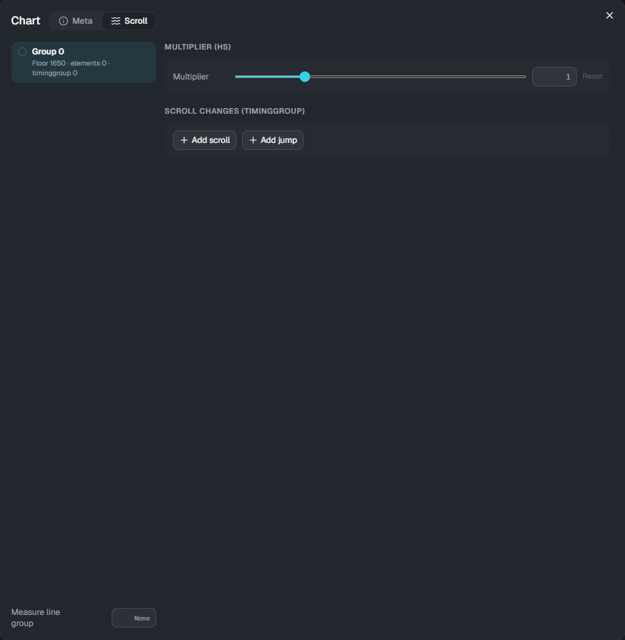

# Scroll

[← Back to the guide](index.md)

Without any settings, floor notes flow according to **the chart's scroll** (scroll / jump in the chart editor's effects).
The Scroll dialog lets you edit the chart's scroll / jump, and change how notes flow **per note group**. **Judgement times do not change**; only where the notes appear does.

Note groups are assigned with the note group feature in the chart editor, or with **Group** in ES3 Studio's [Properties](properties.md). Floor notes without a group are in **group 0 (default)**.

## Opening it

Click **Scroll** in the timeline's tool bar (it opens the Scroll tab of the same dialog as [Meta](meta.md)).

- **Left**: **Chart (.mc)** at the top, then the list of groups, with the number of floor notes, elements and timinggroup entries. Notes, air elements and traces on the timeline are outlined in their group's color
- **Add group**: adds an unused group number to the list (it stays once you set hs or scroll changes, or put notes in it)
- **Right**: settings of the selected item. A group's header shows whether it moves by the chart scroll or by its timinggroup
- **Measure line group**: which group's speed the bar lines follow (group 0 by default)

On a phone held upright, the list is at the top and the table is shown in a compact grid with only time, type, value and Duration (open ease and delete with the ▾ on each row).

## Chart scroll / jump

The scroll and jump effects of the chart (.mc). The table works like the scroll changes below (without Duration or ease).
They are written back to the .mc when you save. Rows that can't be edited here, such as hs or sign, are kept as they are.

Groups without timinggroup move by the chart scroll; it has no effect on groups that have timinggroup.

## Multiplier (hs)

Multiplies the speed of the group by **a fixed rate for the whole song**: 0.1 to 10, with 1 as the default (larger is faster). The ↺ button on the right sets it back to 1.

## Scroll changes (timinggroup)

Speed changes for this group only.

- **+scroll** / **+jump** in the table's header bar add a row at the playhead. New rows always go to the bottom of the table (rows don't move when you change their time; they are sorted by beat when you reopen the dialog)
- The type is a colored tag (light blue for scroll, red for jump). The unit is shown next to the value (× for scroll, ms for jump)
- Only the table scrolls and its column headers stay in place. The row in effect at the playhead gets a colored bar on its left
- Clicking into a row moves the playhead to its time (while stopped)
- **scroll**: from that time, the speed becomes the value. If you fill in **Duration**, it changes smoothly over that many beats following the ease; at `0:0/1` (0) it changes instantly. Duration can be typed as `1:0/1` (beats) or `1000` (ms)
- **jump**: at that time, notes skip ahead by the value (ms)
- Times and Durations are shown as **beat:num/den**, as in Malody's chart editor (the same numbers as `beat` in the .mc; for example `16:1/2` = 16 and 1/2 beats, counted from the start of the song).
  You can type values straight from the chart editor (`[16, 1, 2]` copied from the .mc and `16 1/2` also work). A plain number (`66269`) is read as ms

Once a group has even one scroll change, it **no longer follows the chart's scroll / jump** and moves only at the speeds written here.
Used together with the multiplier (hs), the multiplier also applies to these speeds.

## Assigning groups

Pick a group from the list in **Group** in [Properties](properties.md). **New group** puts it in an unused group number.
With several items selected, you can set them all at once (one Undo reverts it).

Floor notes without a group, and air elements (AirTap, AirSlide, AirLift), traces (Trace, Guide) and bar lines with no group chosen, are in **group 0** (the default).
Group 0's hs and scroll changes apply to all of them.
