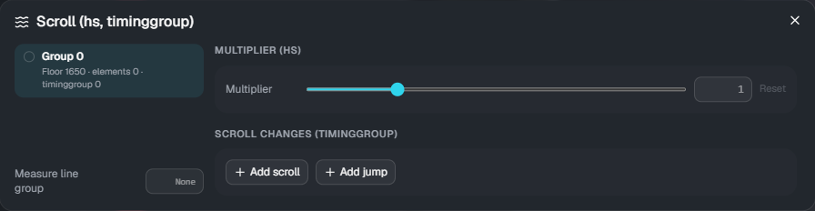

# Scroll

[← Back to the guide](index.md)

Without any settings, floor notes flow according to **the chart's scroll** (scroll / jump in Composer's effects).
The Scroll dialog lets you change this **per note group**. **Judgement times do not change**; only where the notes appear does.

Note groups are assigned with the note group feature in Composer. Notes without a group are in group 0.

## Opening it

Click **Scroll** in the timeline's tool bar.

- **Left**: the list of groups, with the number of floor notes, elements and timinggroup entries. Floor notes on the timeline are colored by group
- **Right**: settings of the selected group
- **Measure line group**: which group's speed the bar lines follow (empty means the chart's scroll)

## Multiplier (hs)

Multiplies the speed of the group by **a fixed rate for the whole song**: 0.1 to 10, with 1 as the default (larger is faster). **Reset** sets it back to 1.

## Scroll changes (timinggroup)

Speed changes for this group only.

- **Add scroll**: from that time, the speed becomes the value. If you fill in "Change over", it changes smoothly over that many beats following the ease; if empty, it changes **instantly**
- **Add jump**: at that time, notes skip ahead by the value (ms)
- Times are typed as bar:beat+fraction (for example `4:2+1/4`)

Used together with the multiplier (hs), the multiplier also applies to these speeds.

## Groups for air elements and traces

Air elements (AirTap, AirSlide, AirLift) and traces (Trace, Guide) follow the chart's scroll unless you specify a group.
Enter a number in **Group** in [Properties](properties.md) to make them follow that group's speed.
