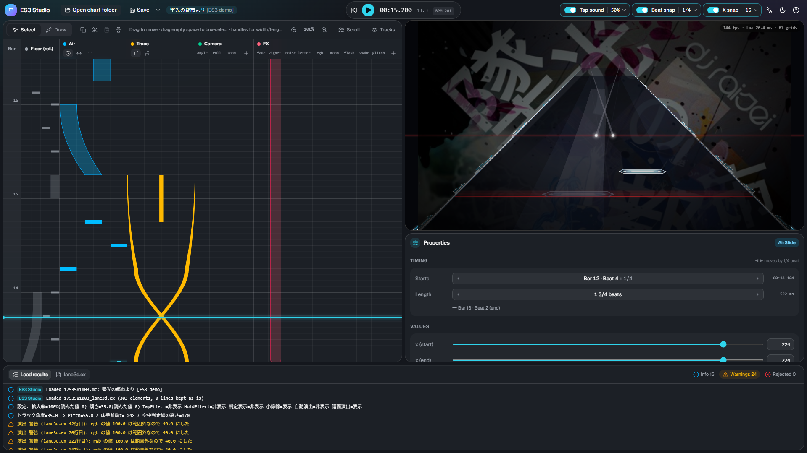

# ES3 Studio User Guide

ES3 Studio is a browser-based editor for `lane3d.ex`, the extension file of **Extra-Slide v3 (ES3)**, a Slide skin for Malody V.
You place air notes, traces, camera moves and screen effects on a beat timeline while watching a 3D preview that looks the same as the game.

## Requirements

| Item     | Details                                                                                                   |
| -------- | --------------------------------------------------------------------------------------------------------- |
| Computer | Windows / macOS / Linux. Phones and tablets are not supported                                             |
| Browser  | **Chrome or Edge (recommended)**. In other browsers, saving works as a download                           |
| Chart    | A Malody V **Slide** chart with **Free Mode on** (the switch in Composer). You open the whole song folder |
| Game     | To check your work in the game, select Extra-Slide v3 as the skin                                         |

Nothing to install: just open the page. Your charts and files are never uploaded; everything runs on your computer.

## Getting started

1. Click **Open chart folder** (in the middle or at the top left) and choose the song folder that contains the chart (`.mc`) → [Open and save](open-save.md)
2. Place elements on the timeline on the left and adjust values in Properties at the bottom right → [Timeline](timeline.md) / [Properties and elements](properties.md)
3. Check how it looks in the game with the preview at the top right and playback (Space)
4. Click **Save** (Ctrl+S) to write `<chart name>_lane3d.ex` into the chart folder. Open the chart in the game to see it

## The screen

| Area                             | What it shows                                                                                       |
| -------------------------------- | --------------------------------------------------------------------------------------------------- |
| Toolbar (top)                    | Open, save, playback and time; tap sound, beat snap, X snap; language, theme and help               |
| Left: timeline                   | Time flows from bottom to top. Place elements in the Floor (ref.), Air, Trace, Camera and FX tracks |
| Top right: preview               | A 3D view that runs the skin's own script. The chart's background image is shown too                |
| Bottom right: properties         | Timing and values of the selected element                                                           |
| Bottom: load results / lane3d.ex | Results of loading (warnings and rejected lines) and the content that will be saved                 |

Drag the gaps between panels to resize them.

## Pages

- [Open and save](open-save.md) — opening a chart folder, which files are read, how to save
- [Timeline](timeline.md) — placing and moving elements, snapping, playback, keyboard shortcuts
- [Properties and elements](properties.md) — editing values and the kinds of elements
- [Scroll](flow.md) — per note group speed (hs, timinggroup)

[Licenses (included software and fonts)](../../THIRD_PARTY_LICENSES.txt)
