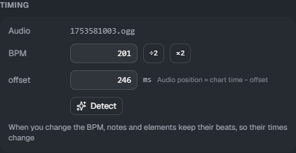

# Chart info (Meta)

[← Back to the guide](index.md)

Change the chart (`.mc`) info: title, difficulty, creator, Free Mode, background image and more.

## Opening it

Click **Meta** in the timeline's tool bar. The tabs at the top of the dialog switch between **Meta** and [Scroll](flow.md).

| Field                   | What it is                                                                                                                                                       |
| ----------------------- | ---------------------------------------------------------------------------------------------------------------------------------------------------------------- |
| Title, Title (original) | The song title. If an original title is set, the game shows that one                                                                                             |
| Artist (and original)   | The artist                                                                                                                                                       |
| Difficulty, Creator     | The difficulty name and the chart's creator                                                                                                                      |
| Free Mode               | Must be **ON** for the ES3 3D lane. A warning appears when it is off                                                                                             |
| Background              | Pick from the images in the chart folder. The background is also used behind the preview                                                                         |
| Preview start           | Where the song starts on the song select screen (audio ms). Click or drag the bar (the song's length) at the bottom, or type a number. "Listen" plays from there |

## Timing (BPM and offset)

| Field  | What it is                                                                                                                                        |
| ------ | ------------------------------------------------------------------------------------------------------------------------------------------------- |
| BPM    | The tempo of the song. ÷2 and ×2 halve and double it. **It cannot be changed in charts whose BPM changes** (change it in the chart editor)        |
| offset | Lines up the audio with the chart (whole ms). Audio position = chart time − offset. A larger offset puts the notes at earlier points in the audio |
| Detect | Finds the BPM and beat positions in the audio and fills in both fields. You can undo it                                                           |

- When you change the BPM, notes and elements **keep their beats** (their times change)
- After detecting, check against the waveform. **The start of the bar (beat 1) may be off** (the offset only lines up the beats).
  If so, add or subtract one beat (60000 ÷ BPM ms) to the offset. If the BPM came out doubled or halved, fix it with ÷2 or ×2
- For songs without a clear beat the detected values may be wrong (a warning is shown)

Changes are written back to the chart (`.mc`) when you **save**. Only the fields you changed are rewritten; nothing else in the file changes.
You can undo them with Ctrl+Z (after closing the dialog, or with Undo in the toolbar).
