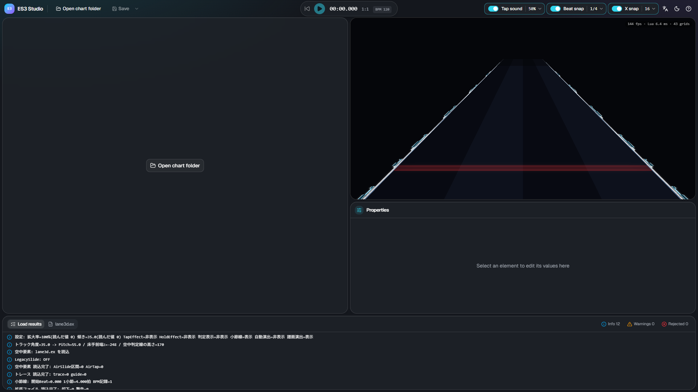
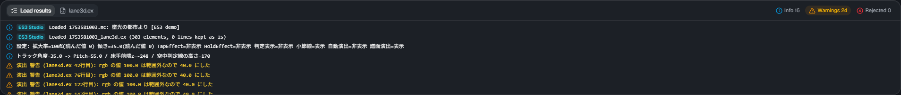
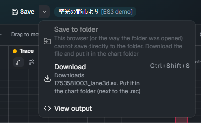
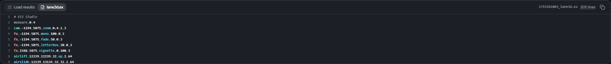

# Open and save

[← Back to the guide](index.md)

## Opening a chart folder

Click **Open chart folder** and choose the song folder that contains the chart (`.mc`). Choose the **folder**, not a file.

- If the folder has one chart, it opens right away
- If it has several, you choose which one to edit. Charts that are not Slide, have Free Mode off, or already have an extension file are marked
- If you have unsaved changes, you are asked before opening

In Chrome and Edge, the browser asks whether the site may view the files. Allow it to open the folder.

### Files that are read

ES3 Studio reads these files from the chart folder.

| File                       | Used for                                                                                                                   |
| -------------------------- | -------------------------------------------------------------------------------------------------------------------------- |
| `<chart name>.mc`          | Floor notes (shown for reference, not edited), BPM, the chart's scroll / jump, the names of the audio and background image |
| `<chart name>_lane3d.ex`   | The extension file you edit. Created if it does not exist                                                                  |
| `<chart name>_chart_3d.ex` | The old name of the extension file. Read only when there is no `_lane3d.ex`                                                |
| `<chart name>_lane3d.src`  | The file of the ES3 plugin for Composer. Read only when neither `.ex` exists                                               |
| Audio                      | Used for playback. Without it, playback is silent                                                                          |
| Background image           | Shown behind the preview (slightly darkened). Without it, there is no background                                           |

## Load results

The **Load results** tab in the bottom panel shows what happened while loading.

- **Info**: which files were read, how many elements, and so on
- **Warnings**: it works, but you may want to check
- **Rejected**: lines the game ignores too. ES3 Studio does not turn them into elements, but **keeps the line as it is** when saving

Lines starting with `[T3D]` are the log of the skin's script (the same as in the game; currently in Japanese).

## Saving

Click **Save** (Ctrl+S) to save `<chart name>_lane3d.ex`. A dot on the button means there are unsaved changes.

- **Chrome and Edge**: writes directly into the chart folder you opened. The first time, the browser asks for permission to write
- **Other browsers** (or when the folder cannot be written): the file is downloaded. Put the downloaded file in the chart folder (next to the `.mc`)

The ▾ next to Save lets you choose how to save.

| Menu                    | What it does                                                                              |
| ----------------------- | ----------------------------------------------------------------------------------------- |
| Save to folder          | Writes directly into the chart folder (only when the folder was opened in Chrome or Edge) |
| Download (Ctrl+Shift+S) | Always available: saves as a download                                                     |
| View output             | Opens the lane3d.ex tab in the bottom panel                                               |

The first time you overwrite a `lane3d.ex` that ES3 Studio did not write (for example, one written by hand), you are asked to confirm.
Overwriting reorders elements by time and moves comments and other non-element lines to the top (their content is kept).

### The output

The **lane3d.ex** tab in the bottom panel shows exactly what will be saved.

- Click a line to select its element (Shift to add)
- Line numbers match "line N" in the game log, so you can find the line when the game shows a warning
- **Copy all** copies the whole file to the clipboard

## Checking in the game

After saving, reopen the chart in the game. Make sure the skin is Extra-Slide v3 and Free Mode is on for the chart.
