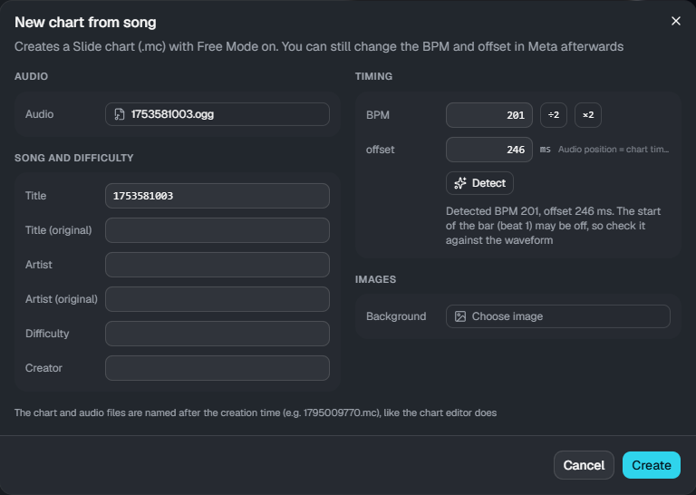
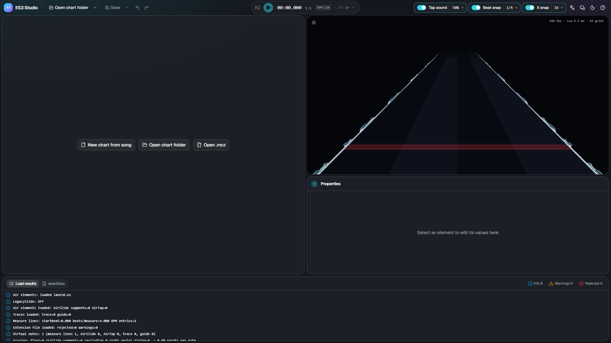
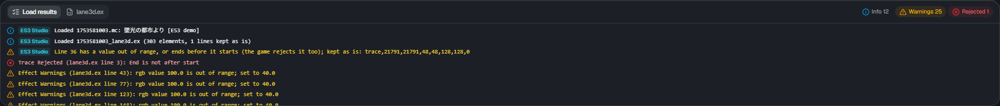
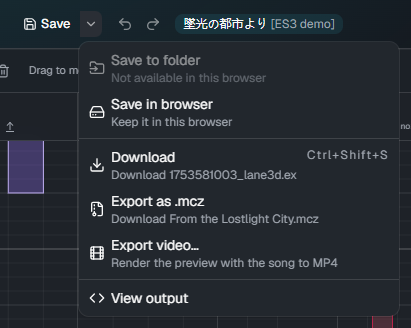
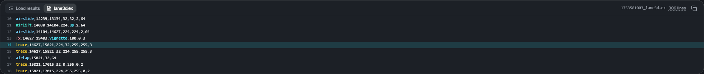
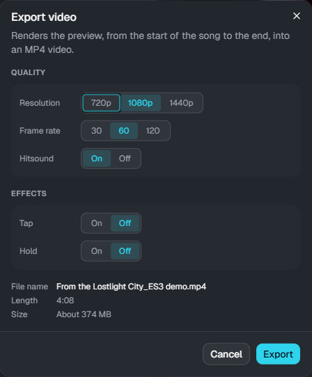

# Open and save

[← Back to the guide](index.md)

## New chart from a song

You can start a new chart for a song that has no chart yet. Click the ▾ next to **Open chart folder**, or **New chart from song** on the screen shown when nothing is open.

1. Click **Choose audio** and pick the song file (`.ogg` or `.mp3`)
2. You are asked "Set the BPM and offset automatically?". **Detect** finds the BPM and beat positions in the song and fills them in ([Timing](meta.md#timing-bpm-and-offset)). Choose **Enter myself** to type them yourself
3. Enter the title, artist, difficulty and creator. The title starts as the audio file name. The creator is remembered for the next chart
4. Choose a background image (optional)
5. Click **Create** to open the empty chart

- The new chart is Slide with **Free Mode on** (needed for the ES3 3D lane)
- Like the chart editor, the chart and audio files are named after the creation time (for example `1794660821.mc` and `1794660821.ogg`)
- **Save** (Ctrl+S) saves **in the browser**. To use the chart in the game, choose **Export as .mcz** from the ▾ next to Save and import it in the game
- You can still change the BPM and offset in [Meta](meta.md) afterwards. For songs whose BPM changes, add the BPM changes in the chart editor

## Opening a chart folder

Click **Open chart folder** and choose the song folder that contains the chart (`.mc`). Choose the **folder**, not a file.

- If the folder has one chart, it opens right away
- If it has several, you choose which one to edit. Charts that are not Slide, have Free Mode off, or already have an extension file are marked
- If you have unsaved changes, you are asked before opening

In Chrome and Edge, the browser asks whether the site may view the files. Allow it to open the folder.

### Files that are read

ES3 Studio reads these files from the chart folder.

| File                       | Used for                                                                                                           |
| -------------------------- | ------------------------------------------------------------------------------------------------------------------ |
| `<chart name>.mc`          | Floor notes (edited and written back), BPM, the chart's scroll / jump, the names of the audio and background image |
| `<chart name>_lane3d.ex`   | The extension file you edit. Created if it does not exist                                                          |
| `<chart name>_chart_3d.ex` | The old name of the extension file. Read only when there is no `_lane3d.ex`                                        |
| `<chart name>_lane3d.src`  | The file of the ES3 plugin for the chart editor. Read only when neither `.ex` exists                               |
| Audio                      | Used for playback. Without it, playback is silent                                                                  |
| Background image           | Shown behind the preview (slightly darkened). Without it, there is no background                                   |

## Opening a .mcz or a chart saved in the browser

Choose from the ▾ next to **Open chart folder**. When nothing is open, the buttons are shown side by side.

- **Open .mcz**: pick a chart package (`.mcz`). Its contents are read the same way as a chart folder (also when they are inside `0/`)
- **Saved in browser**: lists the charts you saved in the browser with **Save**. Click one to continue where you left off, or the trash button to delete it

## Load results

The **Load results** tab in the bottom panel shows what happened while loading.

- **Info**: which files were read, how many elements, and so on
- **Warnings**: it works, but you may want to check
- **Rejected**: lines the game ignores too. ES3 Studio does not turn them into elements, but **keeps the line as it is** when saving

Lines starting with `[T3D]` are the log of the skin's script (the same as in the game; currently in Japanese).

## Saving

Click **Save** (Ctrl+S) to save the current chart (`<chart name>_lane3d.ex`, plus `<chart name>.mc` if you changed floor notes). A dot on the button means there are unsaved changes.

- **When you opened a chart folder in Chrome or Edge**: writes directly into the chart folder. The first time, the browser asks for permission to write
- **Otherwise** (opened from a `.mcz`, or other browsers): **saves inside the browser**, with no download. To use the chart in the game, export it with **Download** or **Export as .mcz** below

Charts saved in the browser are removed when you clear browser data. Export anything you want to keep.

The ▾ next to Save lets you choose how to save.

| Menu                    | What it does                                                                                                                                                            |
| ----------------------- | ----------------------------------------------------------------------------------------------------------------------------------------------------------------------- |
| Save to folder          | Writes directly into the chart folder (only when the folder was opened in Chrome or Edge)                                                                               |
| Save in browser         | Keeps the chart in this browser. Open it again from **Saved in browser**                                                                                                |
| Download (Ctrl+Shift+S) | Downloads `lane3d.ex` (and the `.mc` if you changed the chart). Put them in the chart folder (next to the `.mc`)                                                        |
| Export as .mcz          | Downloads a `.mcz` with the chart folder (other difficulties, audio, background, cover) and your edited `.mc` and `lane3d.ex`. You can import it into the game as it is |
| Export video…           | Renders the preview together with the song to an MP4 video (see **Exporting a video** below)                                                                            |
| View output             | Opens the lane3d.ex tab in the bottom panel                                                                                                                             |

The first time you overwrite the chart (`.mc`), you are asked to confirm. Only what you changed is rewritten; nothing else in the file is touched.
The one exception: ES3 Studio always removes the `$ver` mark from the `.mc` it writes (the chart editor adds it to Free Mode charts, but with it the older Malody cannot read the chart).
If the same chart is open in the MalodyV chart editor, saving there will overwrite your changes from ES3 Studio, so close it first.

The first time you overwrite a `lane3d.ex` that ES3 Studio did not write (for example, one written by hand), you are asked to confirm.
Overwriting reorders elements by time and moves comments and other non-element lines to the top (their content is kept).

### The output

The **lane3d.ex** tab in the bottom panel shows exactly what will be saved.

- Click a line to select its element (Shift to add)
- Line numbers match "line N" in the game log, so you can find the line when the game shows a warning
- **Copy all** copies the whole file to the clipboard

## Exporting a video

**Export video…** in the ▾ next to Save renders the preview together with the song to an MP4 video, from the start of the song to the end.

- **Quality**: choose the resolution (720p, 1080p, 1440p), the frame rate (30, 60, 120) and whether to include tap sounds
- **Effects**: choose whether to show Tap / Hold effects (same as the preview settings)
- How long it takes depends on your device. Keep the tab open until it finishes
- In Chrome and Edge on a PC you can choose where to save. Elsewhere the video is downloaded
- Works in recent Chrome, Edge, Firefox and Safari

## Checking in the game

After saving, reopen the chart in the game. Make sure the skin is Extra-Slide v3 and Free Mode is on for the chart.
