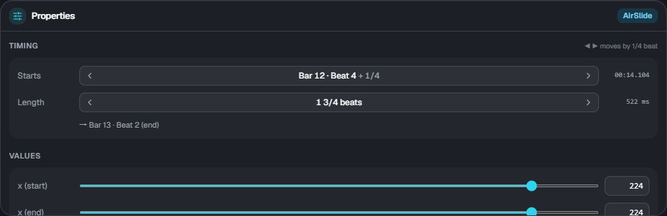
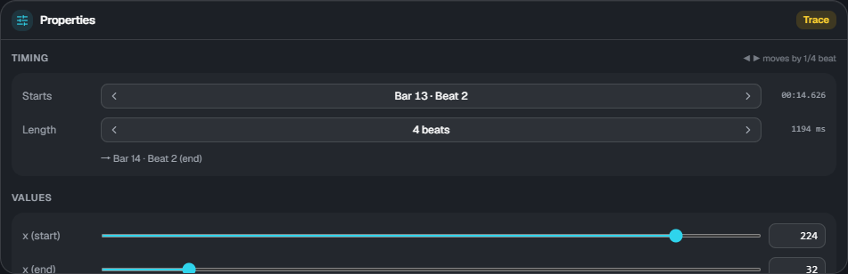

# Properties and elements

[← Back to the guide](index.md)

## Properties

Select one element on the timeline to edit its values in Properties at the bottom right. When several are selected, the count and a hint are shown.

### Timing

- **Starts**: shown as bar, beat and fraction. ◀ ▶ move it by the beat snap step
- **Length**: only for elements with a range. ◀ ▶ make it longer or shorter. The end position is shown below
- On the right is the game time in ms. This is what is written to `lane3d.ex`

### Values

Change them with the sliders or the number fields. x, width and height are **0 to 255** (the same coordinates as floor notes; 64 is about one lane).

- **Ease**: 0 linear / 1 ease in / 2 ease out / 3 ease in-out
- **Group**: air elements and traces can follow the speed of a note group (empty means they follow the chart's scroll). → [Scroll](flow.md)

Colors (`#rrggbb`) and the wavelength of wave cannot be changed in ES3 Studio yet. Whatever is written in `lane3d.ex` is kept as it is.

## Kinds of elements

| Kind               | Track  | What it is                                                                                                                                         |
| ------------------ | ------ | -------------------------------------------------------------------------------------------------------------------------------------------------- |
| Tap / Wipe         | Floor  | A single floor note. Switch between Tap and Wipe and add a flick direction (← ↑ →) in the properties                                               |
| Slide              | Floor  | A floor band following its points. Add a point or remove the last one under "Points" in the properties                                             |
| AirTap             | Air    | A single note on the air judgement line                                                                                                            |
| AirLift            | Air    | A band that moves between the floor and the air judgement line at the same x (up / down). With length 0 it switches at that moment (a right angle) |
| AirSlide           | Air    | A band that moves sideways on the air judgement line                                                                                               |
| Trace              | Trace  | A decorative line without judgement. x and height can change together, so it can go diagonally                                                     |
| Guide              | Trace  | A translucent band on the floor (no judgement). Its position and width can change                                                                  |
| Camera (cam)       | Camera | Tilt, position, distance, roll, zoom and more. After the range it keeps the end value (it does not go back by itself)                              |
| Screen effect (fx) | FX     | Fade, vignette, noise, wave, color shift, flash, shake, glitch and more                                                                            |

For the detailed rules of each element (how to hit them, when warnings appear, and so on), see the [documentation of the Extra-Slide v3 skin](https://m.mugzone.net/store/skin/detail/7674).
The preview and load results in ES3 Studio show the same warnings and rejections as the game.
