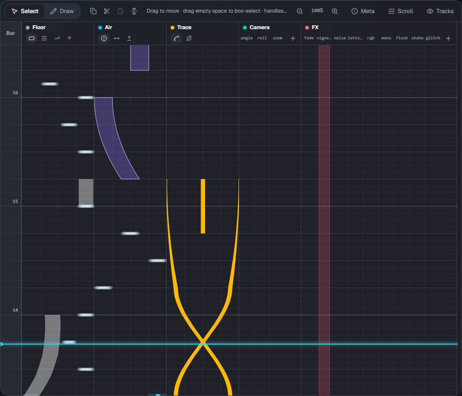
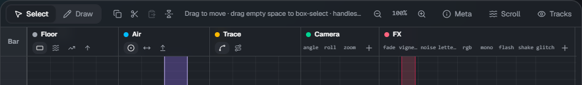
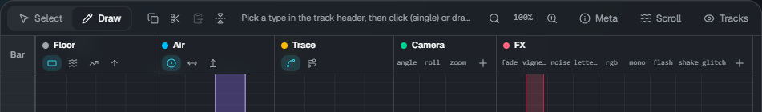
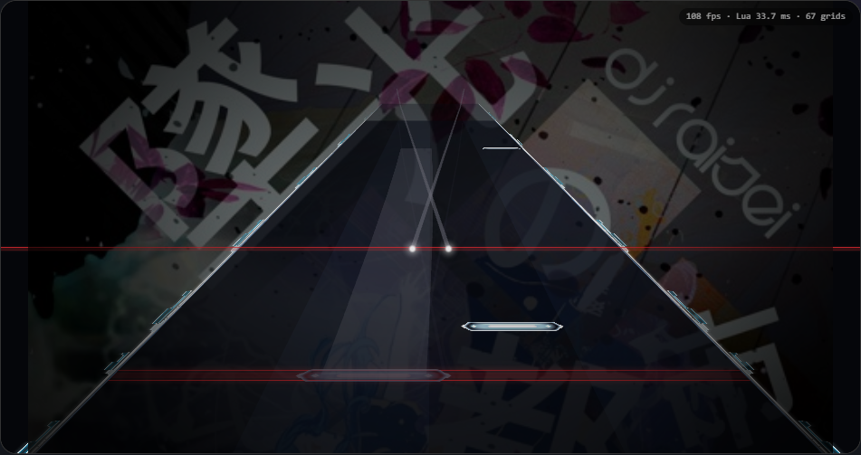

# Timeline

[← Back to the guide](index.md)

Time flows **from bottom to top** (the same direction as the Malody editor). The light blue line is the current position (the playhead).
The numbers on the left are bar numbers. Bar lines follow the `measure` line of `lane3d.ex`.

## Tracks

| Track  | What goes there                                                                       |
| ------ | ------------------------------------------------------------------------------------- |
| Bar    | The bar ruler. Click or drag to move the playhead there                               |
| Floor  | Floor notes from the chart (`.mc`): Tap, Wipe, Slide and Flick. Colored by note group |
| Air    | AirTap, AirSlide, AirLift                                                             |
| Trace  | Trace (line), Guide (band on the floor)                                               |
| Camera | cam. One column per item (angle, roll, zoom, ...). Click ＋ to add a column           |
| FX     | fx. One column per type (fade, flash, glitch, ...). Click ＋ to add a column          |

Use **Tracks** at the top right to hide or show tracks.

## The tool bar

From left to right: **Select / Draw**, copy, cut, paste, mirror, a hint for the current mode, zoom, **Meta** ([chart info](meta.md)), **Scroll** ([Scroll](flow.md)), and visible tracks.

## Selecting and moving (Select mode)

In **Select** mode (V):

- Click an element to select it, drag to move it
- Drag the **handles** of the selected element to change its width, length, end position, or the height of a trace
- Drag on empty space to box-select. **Shift+click** adds to or removes from the selection
- **Delete** (or Backspace) deletes, **Esc** clears the selection
- When several elements are selected, they move together

## Adding (Draw mode)

Switch to **Draw** (B) and click or drag in a track to add elements.

- In the Floor, Air and Trace tracks, pick the **type** with the small buttons in the header (this also switches to Draw mode)
- **Click** for a single note (Tap, Wipe, Flick, AirTap), **drag** for a range (Slide, AirSlide, Trace, ...). Where you drag up to is the end
- A selected floor Slide shows a handle on each point. Add or remove points in the properties
- For Camera and FX, click or drag in the column of the item you want
- New notes use the width you changed last

If something is selected, the first click in a track only clears the selection (click again to add).

## Snapping

**Beat snap** and **X snap** in the toolbar set the steps for placing and moving.

- **Beat snap**: beat division (1/1 to 1/16)
- **X snap**: horizontal step (8, 16, 32, 64; 64 is about one lane)
- The switch on the left turns each on or off. Holding **Alt** bypasses both

## Zoom

**Ctrl+wheel**, or − / ＋ in the tool bar, changes the height of one beat from 25% to 400%. Click the percentage to reset to 100%.

## Copy, paste, mirror

| Action                  | Key             |
| ----------------------- | --------------- |
| Select all              | Ctrl+A          |
| Copy / cut              | Ctrl+C / Ctrl+X |
| Paste (at the playhead) | Ctrl+V          |
| Mirror horizontally     | H               |

## Playback and preview

- **Space** plays / pauses, **Home** goes to the start. The toolbar shows the time, bar:beat and BPM
- The preview runs the skin's own script, so it looks the same as in the game. Changes appear after a short moment
- **Tap sound**: during playback, a sound plays at the head of floor and air notes (not for traces). Use ▾ to change the volume

## Keyboard shortcuts

| Key                   | Action                                 |
| --------------------- | -------------------------------------- |
| Space                 | Play / pause                           |
| Home                  | Go to start                            |
| V / B                 | Select mode / Draw mode                |
| Delete, Backspace     | Delete the selected elements           |
| Esc                   | Clear the selection                    |
| Ctrl+A / C / X / V    | Select all / copy / cut / paste        |
| Ctrl+Z / Ctrl+Y       | Undo / redo (Ctrl+Shift+Z also redoes) |
| H                     | Mirror horizontally                    |
| Alt (hold)            | Bypass snapping                        |
| Ctrl+wheel            | Zoom                                   |
| Ctrl+S / Ctrl+Shift+S | Save / save as download                |

While you are typing in a text field, only the save shortcuts work.
