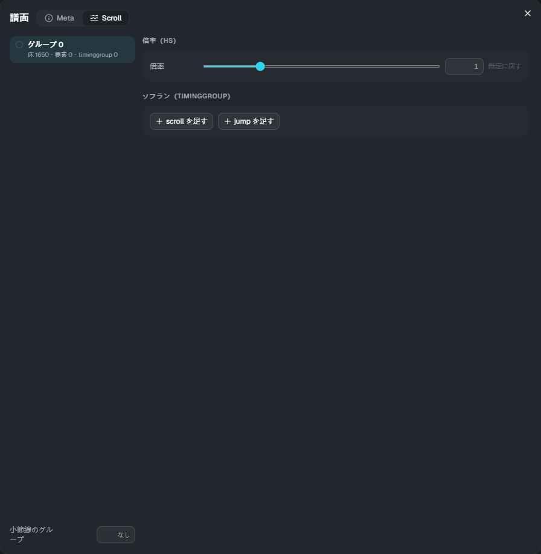

# 流れ方（Scroll）

[← 使い方のトップ](index.md)

床のノーツは、何も書かなければ**譜面の scroll**（譜面エディターの effect の scroll / jump）どおりに流れます。
「流れ方」では、譜面の scroll / jump を直せるほか、**ノーツグループごと**に流れ方を変えられます。**判定の時刻は変わりません**（見える位置だけが変わります）。

ノーツのグループは、譜面エディターのノーツグループ機能か、ES3 Studio の[プロパティ](properties.md)の **グループ** で付けます。グループを付けていない床のノーツは**グループ 0（既定）**です。

## 開き方

タイムラインの道具の帯の **「Scroll」** を押します（[Meta](meta.md) と同じダイアログの、Scroll のタブが開きます）。

- **左**: 一番上が **譜面（.mc）**、その下がグループの一覧です。グループには床のノーツ・要素・timinggroup の数が出ます。タイムラインのノーツ・空中要素・トレースは、グループごとの色で縁取られます
- **グループを足す**: まだ使っていない番号のグループを一覧に足します（hs・ソフランを入れるか、ノーツに付けると残ります）
- **右**: 選んだものの設定。グループの見出しには、譜面の scroll と timinggroup のどちらで流れるかが出ます
- **小節線のグループ**: 小節線をどのグループと同じ流れ方にするか（既定はグループ 0）

スマホの縦持ちでは、一覧が上に並び、表は 時刻・種類・値・Duration だけの詰めた形で出ます（ease・削除は行の ▾ で開きます）。

## 譜面の scroll / jump

譜面（.mc）の effect の scroll と jump です。表の使い方は下のソフランと同じです（Duration・ease はありません）。
保存すると .mc に書き戻します。hs・sign など、ここで直せない行はそのまま残ります。

timinggroup の無いグループは、譜面の scroll で流れます。timinggroup のあるグループには効きません。

## 倍率（hs）

そのグループの流れる速さに、**曲全体で一定の倍率**を掛けます。0.1〜10 で、1 が既定（大きいほど速い）です。右の ↺ で 1 に戻ります。

## ソフラン（timinggroup）

そのグループだけの速さの変化です。

- 表の見出しの帯の **＋scroll** / **＋jump** で、再生線の位置に行を足します。足した行はいつも表の一番下に入ります（時刻を直しても行は動きません。拍の順に並ぶのは、開き直したときです）
- 種類は色の札（scroll は空色、jump は赤）です。値の横に単位（scroll は ×、jump は ms）が出ます
- 表の中だけがスクロールし、列の見出しは止まったままです。再生線の時刻で効いている行は、左に色の帯が付きます
- 行の欄に入ると、再生線がその時刻へ動きます（止まっているとき）
- **scroll**: その時刻から速さを「値」に変えます。**Duration** を入れると、その長さ（拍）をかけて動き方（ease）に沿ってなめらかに変えます。`0:0/1`（0）ならすぐ変わります。Duration は `1:0/1`（拍）でも `1000`（ms）でも打てます
- **jump**: その時刻に、値（ms）の分だけ先へ跳びます
- 時刻と Duration は、譜面（.mc）の beat と同じ数を、Malody の譜面エディターと同じ **拍:分子/分母** で出します（例: `16:1/2` = 16 と 1/2 拍。拍は曲の頭から数えます）。
  譜面エディターの値をそのまま打てます（.mc から写した `[16, 1, 2]`・`16 1/2` も読めます）。ただの数（`66269`）は ms として読みます

ソフランを 1 行でも入れたグループは、**譜面の scroll / jump の影響を受けなくなり**、ここに書いた速さだけで流れます。
倍率（hs）と一緒に使うと、ソフランの速さにさらに倍率が掛かります。

## グループの付け方

[プロパティ](properties.md)の **グループ** で、一覧から選びます。**新しいグループ** を選ぶと、まだ使っていない番号のグループに入れます。
いくつかを選んでいるときは、まとめて付けられます（Undo で 1 回で戻ります）。

グループを付けていない床のノーツと、グループを選んでいない空中要素（AirTap・AirSlide・AirLift）・トレース（Trace・Guide）・小節線は、**グループ 0**（既定）です。
グループ 0 の hs・ソフランは、これらすべてに効きます。
