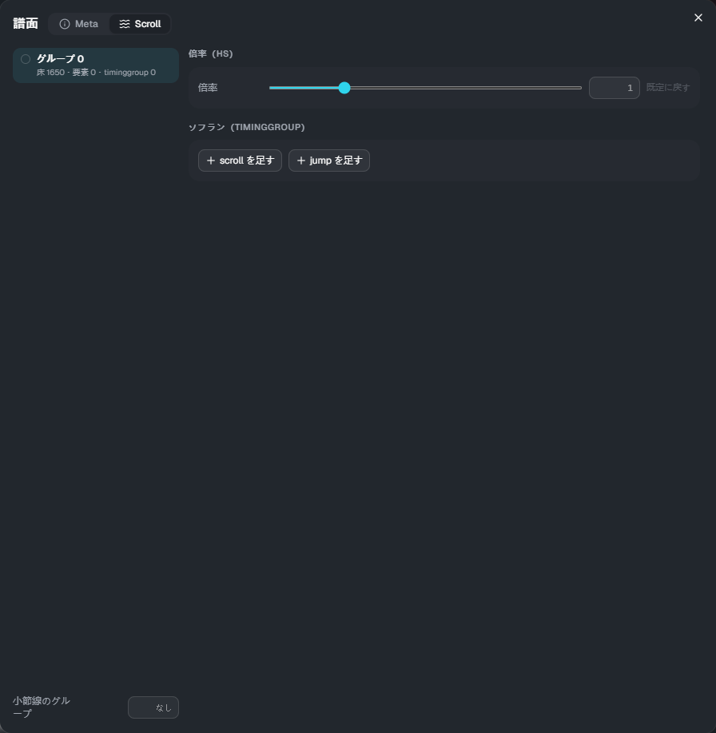

# 流れ方（Scroll）

[← 使い方のトップ](index.md)

床のノーツは、何も書かなければ**譜面の scroll**（譜面エディターの effect の scroll / jump）どおりに流れます。
「流れ方」では、それを**ノーツグループごと**に変えられます。**判定の時刻は変わりません**（見える位置だけが変わります）。

ノーツのグループは、譜面エディターのノーツグループ機能で付けます。グループを付けていないノーツはグループ 0 です。

## 開き方

タイムラインの道具の帯の **「Scroll」** を押します（[Meta](meta.md) と同じダイアログの、Scroll のタブが開きます）。

- **左**: グループの一覧。床のノーツ・要素・timinggroup の数が出ます。タイムラインの床のノーツは、グループごとの色で塗られます
- **右**: 選んだグループの設定
- **小節線のグループ**: 小節線をどのグループと同じ流れ方にするか（空なら譜面の scroll どおり）

## 倍率（hs）

そのグループの流れる速さに、**曲全体で一定の倍率**を掛けます。0.1〜10 で、1 が既定（大きいほど速い）です。「既定に戻す」で 1 に戻ります。

## ソフラン（timinggroup）

そのグループだけの速さの変化です。

- **scroll を足す**: その時刻から速さを「値」に変えます。「変える長さ」を入れると、その長さ（拍）をかけて動き方（ease）に沿ってなめらかに変えます。空なら**すぐ変える**
- **jump を足す**: その時刻に、値（ms）の分だけ先へ跳びます
- 時刻は「小節:拍+分数」（例: `4:2+1/4`）で打ち込みます

倍率（hs）と一緒に使うと、ソフランの速さにさらに倍率が掛かります。

## 空中要素・トレースのグループ

空中要素（AirTap・AirSlide・AirLift）とトレース（Trace・Guide）は、何も指定しなければ譜面の scroll どおりに流れます。
[プロパティ](properties.md)の **グループ** に番号を入れると、そのグループと同じ流れ方になります。
