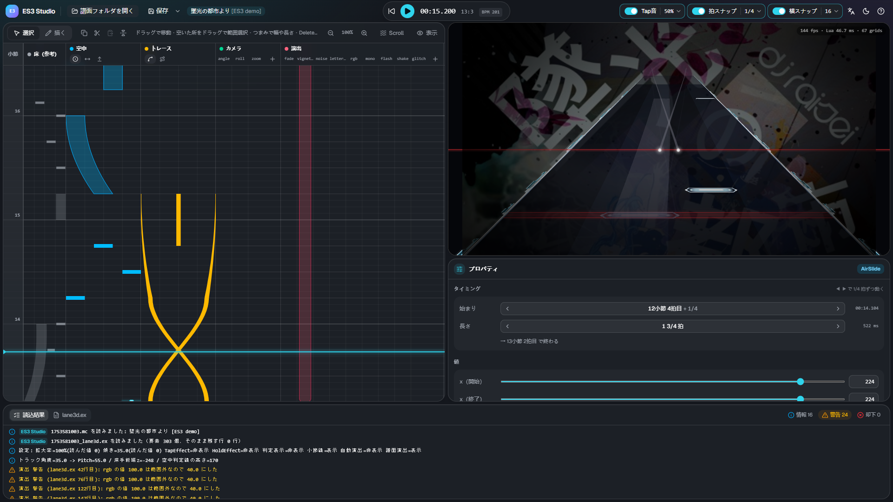

# ES3 Studio の使い方

ES3 Studio は、Malody V の Slide 用スキン **Extra-Slide v3（ES3）** の拡張ファイル `lane3d.ex` を作る、ブラウザで動くエディターです。
空中ノーツ・トレース・カメラ演出・画面演出を、拍のタイムラインと、ゲームと同じ見た目の 3D プレビューを見ながら置けます。

## 必要なもの

| 項目     | 内容                                                                                                 |
| -------- | ---------------------------------------------------------------------------------------------------- |
| パソコン | Windows / macOS / Linux。スマートフォン・タブレットには対応していません                              |
| ブラウザ | **Chrome か Edge（推奨）**。ほかのブラウザでは、保存はダウンロードになります                         |
| 譜面     | Malody V の **Slide** の譜面で、**Free Mode が ON**（Composer のスイッチ）。曲のフォルダごと開きます |
| ゲーム側 | 確かめるときは、スキンに Extra-Slide v3 を選んでおきます                                             |

インストールは要りません。ページを開けばそのまま使えます。譜面やファイルがどこかへ送られることはなく、すべてお使いのパソコンの中で動きます。

## はじめかた

1. 画面の真ん中か左上の **「譜面フォルダを開く」** を押し、譜面（`.mc`）がある曲のフォルダを選びます → [開く・保存](open-save.md)
2. 左のタイムラインで要素を置き、右下のプロパティで値を整えます → [タイムライン](timeline.md) / [プロパティと要素](properties.md)
3. 右上のプレビューと再生（Space）で、ゲームでの見え方を確かめます
4. **「保存」**（Ctrl+S）で `<譜面名>_lane3d.ex` を譜面フォルダに書きます。ゲームで譜面を開くと反映されます

## 画面の見かた

| 場所                     | 内容                                                                                   |
| ------------------------ | -------------------------------------------------------------------------------------- |
| 上のツールバー           | 開く・保存・再生・時刻、Tap音・拍スナップ・横スナップ、言語・テーマ・ヘルプ            |
| 左: タイムライン         | 下から上へ時間が流れます。床（参考）・空中・トレース・カメラ・演出の段に要素を置きます |
| 右上: プレビュー         | スキンのスクリプトをそのまま動かした 3D の画面。背景画像も譜面の指定どおりに出ます     |
| 右下: プロパティ         | 選んだ要素のタイミングと値                                                             |
| 下: 読込結果 / lane3d.ex | 読み込みの結果（警告・却下）と、保存する内容                                           |

パネルの境目はドラッグで大きさを変えられます。

## ページ

- [開く・保存](open-save.md) — 譜面フォルダの開き方、読み込むファイル、保存のしかた
- [タイムライン](timeline.md) — 要素の置き方・動かし方、スナップ、再生、キーの近道
- [プロパティと要素](properties.md) — 値の編集と、要素の種類
- [流れ方（Scroll）](flow.md) — ノーツグループごとの速さ（hs・timinggroup）

[ライセンス（同梱しているソフトウェアとフォント）](../../THIRD_PARTY_LICENSES.txt)
