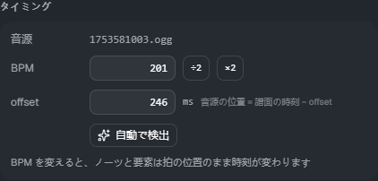

# 譜面の情報（Meta）

[← 使い方のトップ](index.md)

曲名・難易度名・作者・Free Mode・背景画像などの、譜面（`.mc`）の情報を変えられます。

## 開き方

タイムラインの道具の帯の **「Meta」** を押します。ダイアログの上のタブで **Meta** と [Scroll（流れ方）](flow.md) を切り替えられます。

| 項目                   | 内容                                                                                                                                      |
| ---------------------- | ----------------------------------------------------------------------------------------------------------------------------------------- |
| 曲名・曲名（原語）     | 曲名。原語の曲名があれば、ゲームではそちらが出ます                                                                                        |
| アーティスト（・原語） | アーティスト名                                                                                                                            |
| 難易度名・作者         | 難易度の名前と、譜面の作者                                                                                                                |
| Free Mode              | ES3 の 3D レーンには **ON** が必要です。OFF にすると注意が出ます                                                                          |
| 背景画像               | 譜面フォルダの直下の画像から選びます。背景画像はプレビューの背景にもなります                                                              |
| プレビューの開始位置   | 曲を選ぶ画面で曲を流し始める所（音源の ms）。下のバー（曲の長さ）をクリック・ドラッグするか、数で入れます。「試聴」でその位置から流します |

## タイミング（BPM・offset）

| 項目       | 内容                                                                                                                 |
| ---------- | -------------------------------------------------------------------------------------------------------------------- |
| BPM        | 曲の速さ。÷2・×2 で半分・2倍にします。**BPM が途中で変わる譜面では変えられません**（譜面エディターで直してください） |
| offset     | 音源と譜面の位置合わせ（ms の整数）。音源の位置 = 譜面の時刻 − offset。大きくすると、ノーツが音源の早い所に来ます    |
| 自動で検出 | 音源から BPM と拍の位置を見つけて、両方の欄に入れます。Undo で戻せます                                               |

- BPM を変えても、ノーツと要素は**拍の位置のまま**です（時刻が変わります）
- 自動で検出したら、波形を見て確かめてください。**小節の頭（1拍目）がずれる**ことがあります（offset は拍の位置だけを合わせます）。
  そのときは offset に1拍の長さ（60000 ÷ BPM ms）を足すか引きます。BPM が倍・半分になっていたら ÷2・×2 で直します
- 拍がはっきりしない曲では、検出した値が当てにならないことがあります（そのときは注意が出ます）

変えた内容は、**保存**で譜面（`.mc`）に書き戻します。変えた項目の所だけを書き換え、ほかの所は1文字も変えません。
Undo（Ctrl+Z）で戻せます（ダイアログを閉じてから、またはツールバーの「元に戻す」）。
