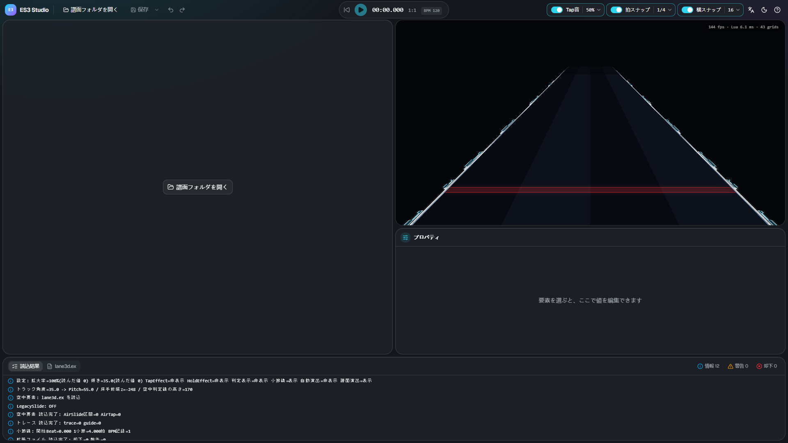
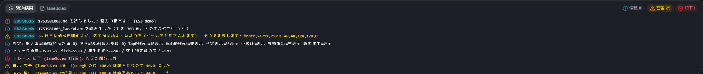
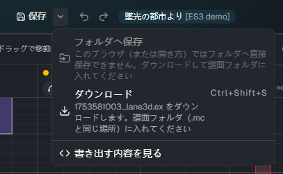
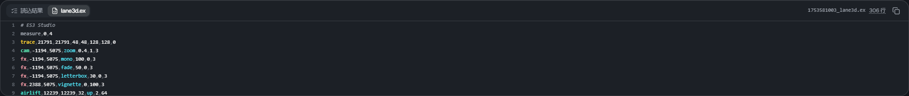

# 開く・保存

[← 使い方のトップ](index.md)

## 譜面フォルダを開く

**「譜面フォルダを開く」** を押し、譜面（`.mc`）がある曲のフォルダを選びます。ファイルではなく**フォルダ**を選びます。

- フォルダに譜面が1つなら、そのまま開きます
- 複数あるときは、どの譜面を編集するかを選ぶ画面が出ます。Slide でない譜面・Free Mode が OFF の譜面・拡張ファイルがある譜面には印が付きます
- 保存していない変更があるときは、開く前に確認が出ます

Chrome・Edge では、ブラウザから「このサイトにファイルの閲覧を許可しますか」と聞かれます。許可すると開けます。

### 読み込むファイル

譜面フォルダの中から、次のファイルを読みます。

| ファイル               | 使い道                                                                              |
| ---------------------- | ----------------------------------------------------------------------------------- |
| `<譜面名>.mc`          | 床のノーツ（編集して書き戻します）・BPM・譜面の scroll / jump・音源と背景画像の名前 |
| `<譜面名>_lane3d.ex`   | 編集する拡張ファイル。無ければ新しく作ります                                        |
| `<譜面名>_chart_3d.ex` | 古い名前の拡張ファイル。`_lane3d.ex` が無いときだけ読みます                         |
| `<譜面名>_lane3d.src`  | 譜面エディターの ES3 プラグインのファイル。どちらの `.ex` も無いときだけ読みます    |
| 音源                   | 再生に使います。無ければ音なしで再生します                                          |
| 背景画像               | プレビューの背景に敷きます（少し暗くします）。無ければ背景なしです                  |

## 読込結果

下のパネルの **「読込結果」** に、読み込みの結果が出ます。

- **情報**: 読んだファイルと要素の数など
- **警告**: 動きますが、確かめたほうがよいこと
- **却下**: ゲームでも無視される行。ES3 Studio でも要素にはせず、**行はそのまま残して**保存します

`[T3D]` で始まる行は、スキンのスクリプトが出したログです（ゲームのログと同じ内容です）。

## 保存

**「保存」**（Ctrl+S）を押すと、`<譜面名>_lane3d.ex` を保存します。床のノーツを変えていれば、譜面（`<譜面名>.mc`）も一緒に保存します。保存していない変更があると、ボタンに点が付きます。

- **Chrome・Edge**: 開いた譜面フォルダへ直接書き込みます。初めて保存するとき、ブラウザから書き込みの許可を求められます
- **ほかのブラウザ**（またはフォルダへ書き込めないとき）: ダウンロードになります。ダウンロードしたファイルを譜面フォルダ（`.mc` と同じ場所）に入れてください

「保存」の横の ▾ から、保存のしかたを選べます。

| メニュー                     | 内容                                                                      |
| ---------------------------- | ------------------------------------------------------------------------- |
| フォルダへ保存               | 譜面フォルダへ直接書き込みます（Chrome・Edge でフォルダを開いたときだけ） |
| ダウンロード（Ctrl+Shift+S） | いつでもダウンロードで保存できます                                        |
| 書き出す内容を見る           | 下のパネルの「lane3d.ex」を開きます                                       |

譜面（`.mc`）を初めて上書きするときは、確認が出ます。変わるのは床のノーツの所だけです（ほかの所は1文字も変えません）。
MalodyV の譜面エディターで同じ譜面を開いたままにしていると、あちらで保存したときに ES3 Studio での変更が上書きされます。先に譜面エディターを閉じてください。

ES3 Studio で書いたのではない `lane3d.ex`（手で書いたものなど）を初めて上書きするときも、確認が出ます。
上書きすると、要素は時刻順に並び直し、コメントなど要素にしない行は先頭にまとまります（行の中身は残ります）。

### 書き出す内容

下のパネルの **「lane3d.ex」** に、保存すると書かれる内容が出ます。

- 行をクリックすると、その要素を選びます（Shift で足す）
- 行番号は、ゲームのログの「◯行目」と同じです。ゲームで警告が出たら、ここで行を探せます
- 「全体をコピー」でクリップボードに写せます

## ゲームで確かめる

保存したら、ゲームで譜面を開き直すと反映されます。スキンに Extra-Slide v3 を選び、譜面の Free Mode が ON になっていることを確かめてください。
