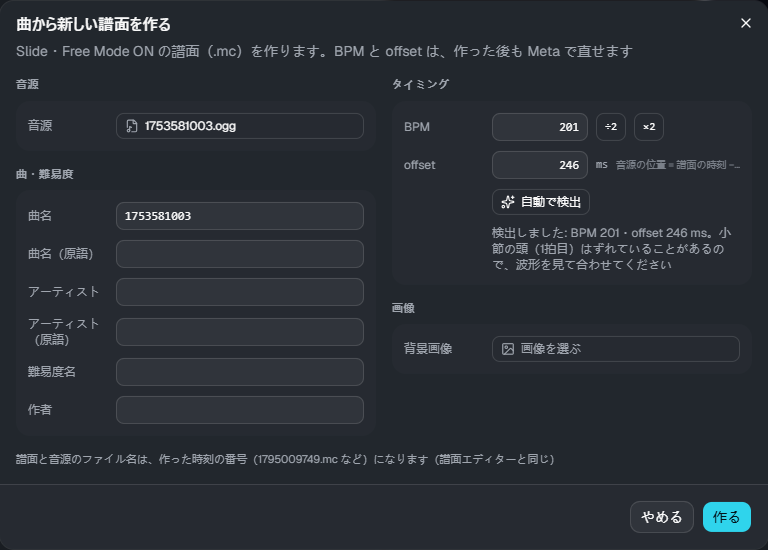
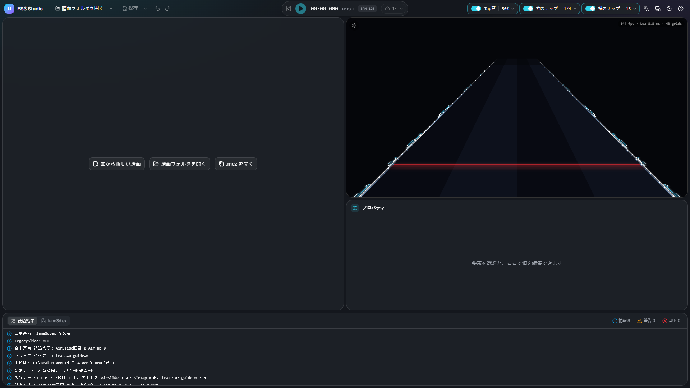
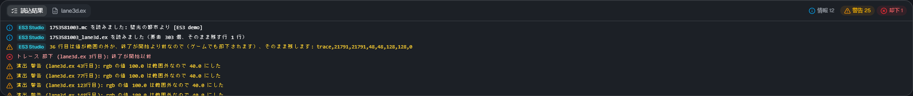
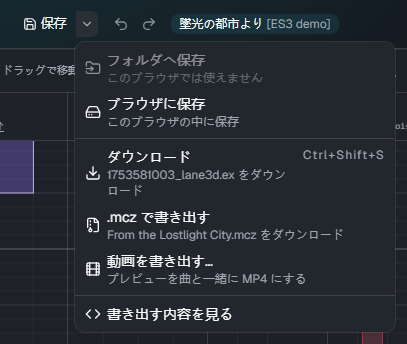
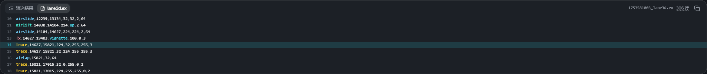
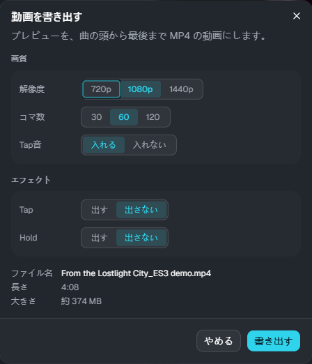

# 開く・保存

[← 使い方のトップ](index.md)

## 曲から新しい譜面を作る

まだ譜面が無い曲から、新しい譜面を作れます。「譜面フォルダを開く」の横の ▾ か、何も開いていない画面の **「曲から新しい譜面」** を押します。

1. **「音源を選ぶ」** で曲のファイル（`.ogg`・`.mp3`）を選びます
2. 「BPM と offset を自動で合わせますか？」と聞かれます。**「検出する」** を押すと、曲から BPM と拍の位置を見つけて欄に入れます（[タイミング](meta.md#タイミングbpmoffset)）。自分で入れるときは「自分で入れる」
3. 曲名・アーティスト・難易度名・作者を入れます。曲名は最初、音源のファイル名が入ります。作者は次に作るときのために覚えておきます
4. 背景画像を選びます（なくてもかまいません）
5. **「作る」** を押すと、空の譜面が開きます

- 作る譜面は Slide・**Free Mode ON** です（ES3 の 3D レーンに必要）
- 譜面と音源のファイル名は、譜面エディターと同じく作った時刻の番号（`1794660821.mc`・`1794660821.ogg` など）になります
- 保存（Ctrl+S）は**ブラウザの中**に保存します。ゲームで使うときは、保存の ▾ から **「.mcz で書き出す」** で書き出し、ゲームで取り込んでください
- BPM と offset は、作った後も [Meta](meta.md) で直せます。BPM が途中で変わる曲は、譜面エディターで BPM を足してください

## 譜面フォルダを開く

**「譜面フォルダを開く」** を押し、譜面（`.mc`）がある曲のフォルダを選びます。ファイルではなく**フォルダ**を選びます。

- フォルダに譜面が1つなら、そのまま開きます
- 複数あるときは、どの譜面を編集するかを選ぶ画面が出ます。Slide でない譜面・Free Mode が OFF の譜面・拡張ファイルがある譜面には印が付きます
- 保存していない変更があるときは、開く前に確認が出ます

Chrome・Edge では、ブラウザから「このサイトにファイルの閲覧を許可しますか」と聞かれます。許可すると開けます。

### 読み込むファイル

譜面フォルダの中から、次のファイルを読みます。

| ファイル               | 使い道                                                                              |
| ---------------------- | ----------------------------------------------------------------------------------- |
| `<譜面名>.mc`          | 床のノーツ（編集して書き戻します）・BPM・譜面の scroll / jump・音源と背景画像の名前 |
| `<譜面名>_lane3d.ex`   | 編集する拡張ファイル。無ければ新しく作ります                                        |
| `<譜面名>_chart_3d.ex` | 古い名前の拡張ファイル。`_lane3d.ex` が無いときだけ読みます                         |
| `<譜面名>_lane3d.src`  | 譜面エディターの ES3 プラグインのファイル。どちらの `.ex` も無いときだけ読みます    |
| 音源                   | 再生に使います。無ければ音なしで再生します                                          |
| 背景画像               | プレビューの背景に敷きます（少し暗くします）。無ければ背景なしです                  |

## .mcz を開く・ブラウザに保存した譜面を開く

「譜面フォルダを開く」の横の ▾ から選びます。何も開いていない画面では、ボタンが並んでいます。

- **.mcz を開く**: 譜面のパッケージ（`.mcz`）を選びます。中身は譜面フォルダと同じように読みます（中身が `0/` の下に入っていても読めます）
- **ブラウザに保存した譜面**: 前に「保存」でブラウザに保存した譜面の一覧が出ます。押すと続きから開き、ゴミ箱のボタンで削除します

## 読込結果

下のパネルの **「読込結果」** に、読み込みの結果が出ます。

- **情報**: 読んだファイルと要素の数など
- **警告**: 動きますが、確かめたほうがよいこと
- **却下**: ゲームでも無視される行。ES3 Studio でも要素にはせず、**行はそのまま残して**保存します

`[T3D]` で始まる行は、スキンのスクリプトが出したログです（ゲームのログと同じ内容です）。

## 保存

**「保存」**（Ctrl+S）を押すと、今の譜面（`<譜面名>_lane3d.ex`。床のノーツを変えていれば `<譜面名>.mc` も）を保存します。保存していない変更があると、ボタンに点が付きます。

- **Chrome・Edge で譜面フォルダを開いたとき**: 譜面フォルダへ直接書き込みます。初めて保存するとき、ブラウザから書き込みの許可を求められます
- **それ以外**（`.mcz` から開いた・ほかのブラウザ）: **ブラウザの中に保存**します。ダウンロードはしません。ゲームで使うときは、下の「ダウンロード」か「.mcz で書き出す」で書き出してください

ブラウザに保存した譜面は、ブラウザのデータを消すと消えます。残しておきたいものは書き出してください。

「保存」の横の ▾ から、保存のしかたを選べます。

| メニュー                     | 内容                                                                                                                                                       |
| ---------------------------- | ---------------------------------------------------------------------------------------------------------------------------------------------------------- |
| フォルダへ保存               | 譜面フォルダへ直接書き込みます（Chrome・Edge でフォルダを開いたときだけ）                                                                                  |
| ブラウザに保存               | このブラウザの中に保存します。「ブラウザに保存した譜面」から開けます                                                                                       |
| ダウンロード（Ctrl+Shift+S） | `lane3d.ex`（譜面を変えていれば `.mc` も）をダウンロードします。譜面フォルダ（`.mc` と同じ場所）に入れてください                                           |
| .mcz で書き出す              | 譜面フォルダの中身（ほかの難易度・音源・背景・カバー）と、編集した `.mc`・`lane3d.ex` をまとめた `.mcz` をダウンロードします。ゲームでそのまま取り込めます |
| 動画を書き出す…              | プレビューを曲と一緒に MP4 の動画にします（下の「動画を書き出す」）                                                                                        |
| 書き出す内容を見る           | 下のパネルの「lane3d.ex」を開きます                                                                                                                        |

譜面（`.mc`）を初めて上書きするときは、確認が出ます。変わるのは変えた所だけです（ほかの所は1文字も変えません）。
ただし、書き出す `.mc` からは `$ver` という印をいつも消します（MalodyV の譜面エディターが Free Mode の譜面に付けますが、これがあると旧版の Malody で譜面が読めないため）。
MalodyV の譜面エディターで同じ譜面を開いたままにしていると、あちらで保存したときに ES3 Studio での変更が上書きされます。先に譜面エディターを閉じてください。

ES3 Studio で書いたのではない `lane3d.ex`（手で書いたものなど）を初めて上書きするときも、確認が出ます。
上書きすると、要素は時刻順に並び直し、コメントなど要素にしない行は先頭にまとまります（行の中身は残ります）。

### 書き出す内容

下のパネルの **「lane3d.ex」** に、保存すると書かれる内容が出ます。

- 行をクリックすると、その要素を選びます（Shift で足す）
- 行番号は、ゲームのログの「◯行目」と同じです。ゲームで警告が出たら、ここで行を探せます
- 「全体をコピー」でクリップボードに写せます

## 動画を書き出す

保存の ▾ の **「動画を書き出す…」** で、プレビューを曲と一緒に MP4 の動画にします。範囲は曲の頭から最後までです。

- **画質**: 解像度（720p・1080p・1440p）とコマ数（30・60・120）、Tap音を入れるかを選べます
- **エフェクト**: Tap / Hold のエフェクトを出すかを選べます（プレビューの設定と同じ）
- 書き出す時間は端末によって変わります。終わるまでタブを開いたままにしてください
- Chrome・Edge（パソコン）では保存先を選べます。それ以外はダウンロードになります
- 最新の Chrome・Edge・Firefox・Safari で使えます

## ゲームで確かめる

保存したら、ゲームで譜面を開き直すと反映されます。スキンに Extra-Slide v3 を選び、譜面の Free Mode が ON になっていることを確かめてください。
