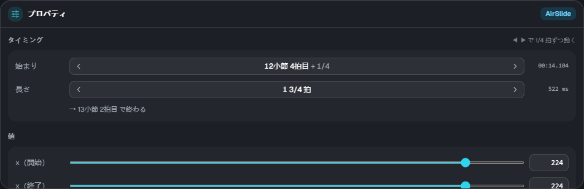
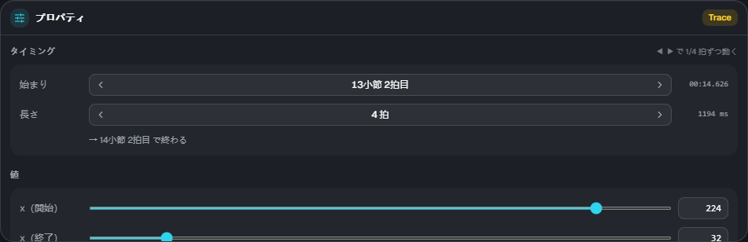

# プロパティと要素

[← 使い方のトップ](index.md)

## プロパティ

タイムラインで要素を1つ選ぶと、右下のプロパティで値を編集できます。複数選んだときは、選んだ数と操作のヒントが出ます。

### タイミング

- **始まり**: 「小節・拍目＋分数」で表示します。◀ ▶ で拍スナップの刻みずつ動きます
- **長さ**: 区間のある要素だけ。◀ ▶ で伸び縮みします。下に終わりの位置が出ます
- 右端に、ゲームの時刻（ms）が出ます。`lane3d.ex` にはこの ms で書かれます

### 値

スライダーか数字の欄で変えます。x・幅・高さは **0〜255**（床のノーツと同じ座標。64 がおよそ1レーン）です。

- **動き方（ease）**: 0 直線 / 1 遅く出て加速 / 2 速く出て減速 / 3 両端がゆるやか
- **グループ**: 空中要素・トレースは、ノーツグループと同じ流れ方にできます（空なら譜面の scroll どおり）。→ [流れ方](flow.md)

色（`#rrggbb`）や wave の波長は、今のところ ES3 Studio では変えられません。`lane3d.ex` に書いてあるものはそのまま残ります。

## 要素の種類

| 種類              | 段       | 内容                                                                                                     |
| ----------------- | -------- | -------------------------------------------------------------------------------------------------------- |
| Tap / Wipe        | 床       | 床の単発ノーツ。プロパティで Tap と Wipe を切り替え、フリックの向き（← ↑ →）を付けられる                 |
| Slide             | 床       | 中継点をたどる床の帯。プロパティの「中継点」で点を足す・最後の点を消す                                   |
| AirTap            | 空中     | 空中判定線の上の単発ノーツ                                                                               |
| AirLift           | 空中     | 同じ x のまま、床 ⇄ 空中判定線を行き来する帯（上げる / 下ろす）。長さ 0 にすると、その瞬間に移る「直角」 |
| AirSlide          | 空中     | 空中判定線の上を横に動く帯                                                                               |
| Trace             | トレース | 判定の無い飾りの線。x と高さを同時に動かせるので、斜めの動きもできる                                     |
| Guide             | トレース | 床に置く半透明の帯（判定なし）。位置と幅が変わる                                                         |
| カメラ演出（cam） | カメラ   | 傾き・位置・距離・回転・ズームなど。区間の後は終了値のまま（自動では戻らない）                           |
| 画面演出（fx）    | 演出     | 暗転・ビネット・ノイズ・波・色収差・フラッシュ・揺れ・グリッチなど                                       |

要素のくわしい決まり（取り方・警告の条件など）は、[スキン Extra-Slide v3 の説明](https://m.mugzone.net/store/skin/detail/7674)を見てください。
ES3 Studio のプレビューと読込結果には、ゲームと同じ警告・却下が出ます。
