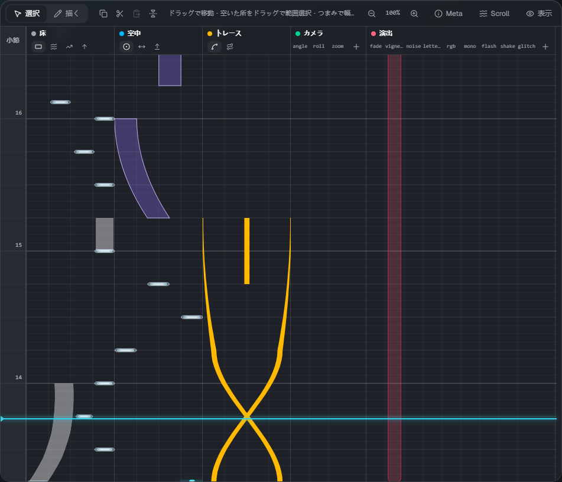
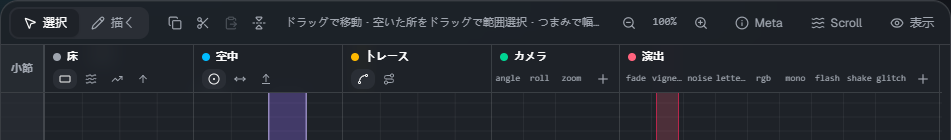
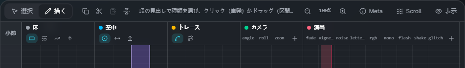
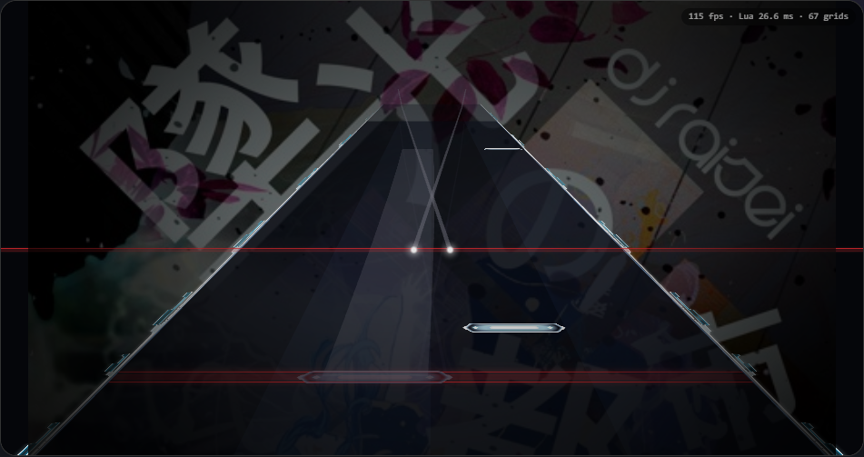

# タイムライン

[← 使い方のトップ](index.md)

時間は**下から上へ**流れます（Malody のエディターと同じ向き）。水色の横線が今の位置（再生線）です。
左端の数字は小節の番号で、小節線は `lane3d.ex` の `measure` の行に合わせて引きます。

## 段

| 段       | 置くもの                                                                                  |
| -------- | ----------------------------------------------------------------------------------------- |
| 小節     | 小節の目盛り。クリック・ドラッグで再生線をその位置へ動かします                            |
| 床       | 譜面（`.mc`）の床のノーツ（Tap・Wipe・Slide・フリック）。ノーツグループごとに色が付きます |
| 空中     | AirTap・AirSlide・AirLift                                                                 |
| トレース | Trace（線）・Guide（床の帯）                                                              |
| カメラ   | cam。項目（angle・roll・zoom など）ごとに列があります。＋ で列を足せます                  |
| 演出     | fx。種類（fade・flash・glitch など）ごとに列があります。＋ で列を足せます                 |

右上の **「表示」** で、段を隠したり出したりできます。

## 道具の帯

左から、**選択 / 描く**の切り替え、コピー・切り取り・貼り付け・左右反転、操作のヒント、伸縮、**Meta**（[譜面の情報](meta.md)）・**Scroll**（[流れ方](flow.md)）、表示する段です。

## 選ぶ・動かす（選択モード）

**選択**（V）のときの操作です。

- 要素をクリックで選び、ドラッグで動かします
- 選んだ要素に出る**つまみ**をドラッグすると、幅・長さ・終わりの位置・トレースの高さを変えられます
- 何も無い所をドラッグすると、範囲で選べます。**Shift+クリック**で選択に足す / 外す
- **Delete**（または Backspace）で削除、**Esc** で選択を外します
- 複数を選ぶと、まとめて動かせます

## 足す（描くモード）

**描く**（B）にして、段をクリック・ドラッグすると要素を足せます。

- 床・空中・トレースの段は、見出しの小さなボタンで**種類**を選びます（押すと描くモードになります）
- **クリック**で単発（Tap・Wipe・フリック・AirTap）、**ドラッグ**で区間（Slide・AirSlide・Trace など）を作ります。上へドラッグした所が終わりです
- 床の Slide は、選ぶと中継点ごとにつまみが出ます。中継点を足す・消すのはプロパティで行います
- カメラ・演出は、置きたい項目の列をクリック・ドラッグします
- 新しく足すノーツの幅は、最後に変えた幅を使います

何か選んでいるときに段をクリックすると、まず選択が外れます（もう一度クリックすると足せます）。

## スナップ

ツールバーの **拍スナップ** と **横スナップ** で、置く・動かすときの刻みを決めます。

- **拍スナップ**: 1拍の分割（1/1〜1/16）
- **横スナップ**: 横位置の刻み（8・16・32・64。64 がおよそ1レーン）
- 左のスイッチで ON / OFF。**Alt** を押している間は、一時的に両方切れます

## 伸縮

**Ctrl+ホイール**か、帯の − / ＋ で、1拍の高さを 25〜400% に変えられます。倍率を押すと 100% に戻ります。

## コピー・貼り付け・左右反転

| 操作                       | キー            |
| -------------------------- | --------------- |
| すべて選ぶ                 | Ctrl+A          |
| コピー / 切り取り          | Ctrl+C / Ctrl+X |
| 貼り付け（再生線の位置へ） | Ctrl+V          |
| 左右反転                   | H               |

## 再生とプレビュー

- **Space** で再生 / 一時停止、**Home** で先頭へ。ツールバーに時刻・小節:拍・BPM が出ます
- プレビューはスキンのスクリプトをそのまま動かしているので、ゲームと同じ見え方です。要素を変えると少し後に反映されます
- **Tap音**: 再生中、床と空中のノーツの頭で音を鳴らします（トレースは鳴りません）。▾ で音量を変えられます

## キーボードショートカット

| キー                  | 内容                                             |
| --------------------- | ------------------------------------------------ |
| Space                 | 再生 / 一時停止                                  |
| Home                  | 先頭へ                                           |
| V / B                 | 選択モード / 描くモード                          |
| Delete・Backspace     | 選んだ要素を削除                                 |
| Esc                   | 選択を外す                                       |
| Ctrl+A / C / X / V    | すべて選ぶ / コピー / 切り取り / 貼り付け        |
| Ctrl+Z / Ctrl+Y       | 元に戻す / やり直す（Ctrl+Shift+Z でもやり直す） |
| H                     | 左右反転                                         |
| Alt（押している間）   | スナップを一時的に切る                           |
| Ctrl+ホイール         | 伸縮                                             |
| Ctrl+S / Ctrl+Shift+S | 保存 / ダウンロードで保存                        |

文字を打つ欄にいるときは、保存以外のキーは効きません。
