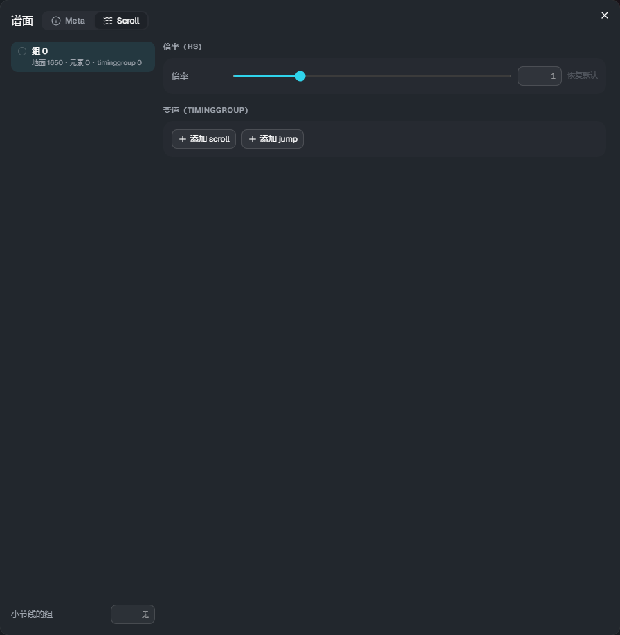

# 流速（Scroll）

[← 返回使用说明首页](index.md)

如果什么都不设置，地面音符会按照**谱面的 scroll**（谱面编辑器中 effect 的 scroll / jump）流动。
「流速」既可以修改谱面的 scroll / jump，也可以**按音符组**改变流动方式。**判定的时间不会改变**（只改变看到的位置）。

音符组可以用谱面编辑器的音符组功能，或 ES3 Studio [属性](properties.md)中的 **组** 设置。没有设置组的地面音符属于**组 0（默认）**。

## 打开方式

点击时间轴工具栏上的 **「Scroll」**（会打开与 [Meta](meta.md) 同一个对话框的 Scroll 标签）。

- **左侧**：最上方是 **谱面（.mc）**，下面是组的列表。组会显示地面音符・元素・timinggroup 的数量。时间轴上的音符・空中元素・描线会用组的颜色描边
- **添加组**：把一个还没用过的编号加入列表（设置 hs・变速，或给音符设置这个组后就会保留）
- **右侧**：选中项的设置。组的标题会显示它是按谱面的 scroll 还是按 timinggroup 流动
- **小节线的组**：让小节线使用哪个组的流速（默认为组 0）

手机竖屏时，列表排在上方，表格以只含 时间・类型・值・Duration 的紧凑形式显示（ease・删除点行右侧的 ▾ 展开）。

## 谱面的 scroll / jump

谱面（.mc）effect 中的 scroll 和 jump。表格的用法与下面的变速相同（没有 Duration・ease）。
保存时写回 .mc。hs・sign 等这里不能修改的行会保持原样。

没有 timinggroup 的组按谱面的 scroll 流动；对有 timinggroup 的组不生效。

## 倍率（hs）

为该组的流动速度乘上**整首歌固定的倍率**。范围 0.1〜10，默认为 1（越大越快）。点右侧的 ↺ 恢复为 1。

## 变速（timinggroup）

只属于该组的速度变化。

- 用表格标题栏的 **＋scroll** / **＋jump** 在播放线的位置添加一行。新添加的行总是在表格最下方（修改时间后行也不会移动；重新打开时才按拍的顺序排列）
- 类型以彩色标签显示（scroll 为浅蓝，jump 为红）。值的旁边会显示单位（scroll 是 ×，jump 是 ms）
- 只有表格内部会滚动，列标题保持不动。播放线所在时间生效的那一行左侧会显示色条
- 点进某一行的输入框时，播放线会移到该时间（停止播放时）
- **scroll**：从该时间起把速度改为「值」。填写 **Duration** 后，会在这段长度（拍）内按缓动（ease）平滑地改变；为 `0:0/1`（0）时立即改变。Duration 可以输入 `1:0/1`（拍）或 `1000`（ms）
- **jump**：在该时间向前跳过「值」（ms）
- 时间和 Duration 与谱面（.mc）的 beat 相同，以与 Malody 谱面编辑器相同的 **拍:分子/分母** 显示（例：`16:1/2` = 16 又 1/2 拍。拍从歌曲开头算起）。
  可以直接输入谱面编辑器中的值（从 .mc 复制的 `[16, 1, 2]`、全角的 `16：1／2`、`16 1/2` 也可以）。纯数字（`66269`）按 ms 读取

只要添加了一行变速，该组就**不再受谱面的 scroll / jump 影响**，只按这里写的速度流动。
与倍率（hs）一起使用时，变速的速度还会再乘上倍率。

## 设置组的方法

在[属性](properties.md)的 **组** 中从列表选择。选 **新建组** 会放入一个还没用过编号的组。
选中多个时可以一次设置（撤销一次即可恢复）。

未设置组的地面音符，以及未选择组的空中元素（AirTap・AirSlide・AirLift）、描线（Trace・Guide）和小节线，都属于**组 0**（默认）。
组 0 的 hs・变速对它们全部生效。
