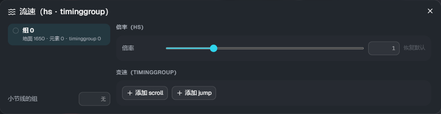

# 流速（Scroll）

[← 返回使用说明首页](index.md)

如果什么都不设置，地面音符会按照**谱面的 scroll**（Composer 中 effect 的 scroll / jump）流动。
「流速」可以**按音符组**改变这一点。**判定的时间不会改变**（只改变看到的位置）。

音符组用 Composer 的音符组功能设置。没有设置组的音符属于组 0。

## 打开方式

点击时间轴工具栏上的 **「Scroll」**。

- **左侧**：组的列表。显示地面音符・元素・timinggroup 的数量。时间轴上的地面音符会按组显示颜色
- **右侧**：选中组的设置
- **小节线的组**：让小节线使用哪个组的流速（留空则按谱面的 scroll）

## 倍率（hs）

为该组的流动速度乘上**整首歌固定的倍率**。范围 0.1〜10，默认为 1（越大越快）。点击「恢复默认」恢复为 1。

## 变速（timinggroup）

只属于该组的速度变化。

- **添加 scroll**：从该时间起把速度改为「值」。填写「变化长度」后，会在这段长度（拍）内按缓动（ease）平滑地改变；留空则**立即改变**
- **添加 jump**：在该时间向前跳过「值」（ms）
- 时间以「小节:拍+分数」（例：`4:2+1/4`）输入

与倍率（hs）一起使用时，变速的速度还会再乘上倍率。

## 空中元素・描线的组

空中元素（AirTap・AirSlide・AirLift）和描线（Trace・Guide）如果不指定，会按照谱面的 scroll 流动。
在[属性](properties.md)的 **组** 中填写编号后，就会使用与该组相同的流速。
