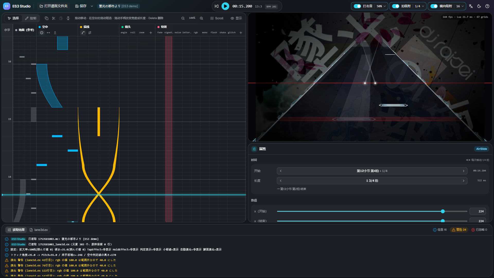

# ES3 Studio 使用说明

ES3 Studio 是一款在浏览器中运行的编辑器，用来制作 Malody V 的 Slide 皮肤 **Extra-Slide v3（ES3）** 的扩展文件 `lane3d.ex`。
可以一边看按拍排列的时间轴和与游戏相同画面的 3D 预览，一边放置空中音符、描线、镜头演出和画面特效。

## 需要准备

| 项目   | 内容                                                                                           |
| ------ | ---------------------------------------------------------------------------------------------- |
| 电脑   | Windows / macOS / Linux。不支持手机和平板                                                      |
| 浏览器 | **推荐 Chrome 或 Edge**。其他浏览器只能以下载的方式保存                                        |
| 谱面   | Malody V 的 **Slide** 谱面，并且 **Free Mode 已开启**（Composer 中的开关）。打开整个歌曲文件夹 |
| 游戏   | 在游戏中确认时，请把皮肤设为 Extra-Slide v3                                                    |

无需安装，打开网页即可使用。谱面和文件不会被上传到任何地方，所有处理都在你的电脑上完成。

## 开始使用

1. 点击画面中央或左上角的 **「打开谱面文件夹」**，选择谱面（`.mc`）所在的歌曲文件夹 → [打开与保存](open-save.md)
2. 在左侧时间轴上放置元素，在右下角的属性中调整数值 → [时间轴](timeline.md) / [属性与元素](properties.md)
3. 用右上角的预览和播放（Space）确认在游戏中的效果
4. 点击 **「保存」**（Ctrl+S），把 `<谱面名>_lane3d.ex` 写入谱面文件夹。在游戏中打开谱面即可生效

## 画面说明

| 位置                       | 内容                                                                   |
| -------------------------- | ---------------------------------------------------------------------- |
| 上方工具栏                 | 打开・保存・播放・时间、打击音・拍吸附・横向吸附、语言・主题・帮助     |
| 左：时间轴                 | 时间从下往上流动。在地面（参考）・空中・描线・镜头・特效轨道上放置元素 |
| 右上：预览                 | 直接运行皮肤脚本的 3D 画面。背景图片也按谱面的设置显示                 |
| 右下：属性                 | 选中元素的时间和数值                                                   |
| 下方：读取结果 / lane3d.ex | 读取结果（警告・已忽略）和将要保存的内容                               |

拖动面板之间的边界可以调整大小。

## 页面

- [打开与保存](open-save.md) — 如何打开谱面文件夹、读取哪些文件、如何保存
- [时间轴](timeline.md) — 放置和移动元素、吸附、播放、快捷键
- [属性与元素](properties.md) — 编辑数值，以及元素的类型
- [流速（Scroll）](flow.md) — 按音符组设置速度（hs・timinggroup）

[许可证（包含的软件和字体）](../../THIRD_PARTY_LICENSES.txt)
