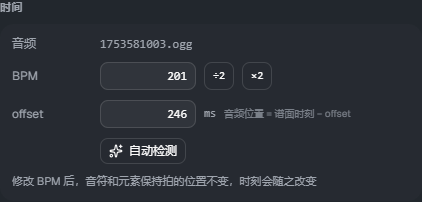

# 谱面信息（Meta）

[← 返回使用说明首页](index.md)

可以修改曲名・难度名・作者・Free Mode・背景图片等谱面（`.mc`）的信息。

## 打开方式

点击时间轴工具栏上的 **「Meta」**。在对话框上方的标签中可以切换 **Meta** 和 [Scroll（流速）](flow.md)。

| 项目               | 内容                                                                                                          |
| ------------------ | ------------------------------------------------------------------------------------------------------------- |
| 曲名・曲名（原文） | 曲名。如果有原文曲名，游戏中会显示原文曲名                                                                    |
| 艺术家（・原文）   | 艺术家名                                                                                                      |
| 难度名・作者       | 难度的名称和谱面作者                                                                                          |
| Free Mode          | ES3 的 3D 轨道需要 **ON**。设为 OFF 时会显示提示                                                              |
| 背景图片           | 从谱面文件夹中的图片里选择。背景图片也会作为预览的背景                                                        |
| 预览的开始位置     | 选曲界面开始播放的位置（音频的 ms）。点击・拖动下方的条（歌曲长度），或直接输入数字。点击「试听」从该位置播放 |

## 时间（BPM・offset）

| 项目     | 内容                                                                                            |
| -------- | ----------------------------------------------------------------------------------------------- |
| BPM      | 歌曲的速度。÷2・×2 可减半・加倍。**BPM 中途变化的谱面无法修改**（请在谱面编辑器中修改）         |
| offset   | 音频与谱面的对齐（ms 的整数）。音频位置 = 谱面时刻 − offset。数值越大，音符对应音频中越早的位置 |
| 自动检测 | 从音频中找出 BPM 和节拍位置，填入两个栏中。可以用 Undo 撤销                                     |

- 修改 BPM 后，音符和元素**保持拍的位置不变**（时刻会改变）
- 自动检测后，请对照波形确认。**小节开头（第 1 拍）可能有偏差**（offset 只对齐节拍位置）。
  这时请在 offset 上加减一拍的长度（60000 ÷ BPM ms）。BPM 变成两倍或一半时，用 ÷2・×2 修正
- 节拍不明显的歌曲，检测结果可能不准确（此时会出现提示）

修改的内容会在**保存**时写回谱面（`.mc`）。只会改写修改过的项目，其他部分一个字也不会改。
可以用 Undo（Ctrl+Z）撤销（关闭对话框后，或使用工具栏的「撤销」）。
