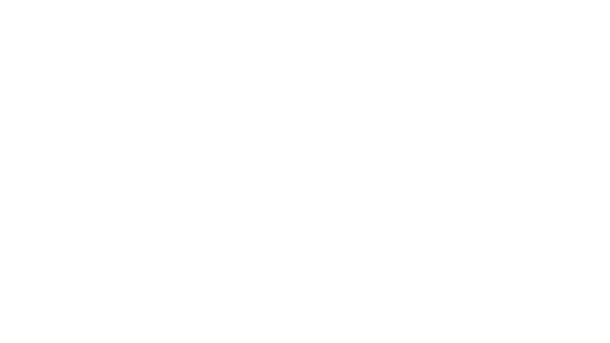
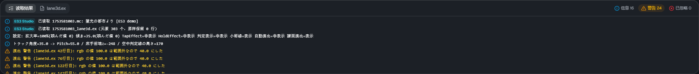
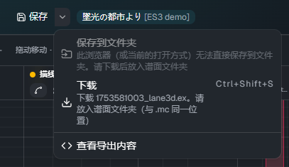
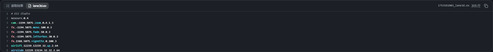

# 打开与保存

[← 返回使用说明首页](index.md)

## 打开谱面文件夹

点击 **「打开谱面文件夹」**，选择谱面（`.mc`）所在的歌曲文件夹。请选择**文件夹**，而不是文件。

- 文件夹中只有一个谱面时，会直接打开
- 有多个谱面时，会出现选择要编辑的谱面的画面。不是 Slide 的谱面、Free Mode 未开启的谱面、已有扩展文件的谱面会带有标记
- 有尚未保存的修改时，打开前会先确认

在 Chrome・Edge 中，浏览器会询问是否允许网站查看文件。允许后即可打开。

### 读取的文件

从谱面文件夹中读取以下文件。

| 文件                   | 用途                                                                                |
| ---------------------- | ----------------------------------------------------------------------------------- |
| `<谱面名>.mc`          | 地面音符（仅作参考显示，不编辑）・BPM・谱面的 scroll / jump・音频和背景图片的文件名 |
| `<谱面名>_lane3d.ex`   | 要编辑的扩展文件。没有时会新建                                                      |
| `<谱面名>_chart_3d.ex` | 旧名称的扩展文件。仅在没有 `_lane3d.ex` 时读取                                      |
| `<谱面名>_lane3d.src`  | Composer 的 ES3 插件的文件。仅在两种 `.ex` 都没有时读取                             |
| 音频                   | 用于播放。没有时无声播放                                                            |
| 背景图片               | 铺在预览的背景上（会稍微调暗）。没有时不显示背景                                    |

## 读取结果

下方面板的 **「读取结果」** 中会显示读取的结果。

- **信息**：读取的文件和元素数量等
- **警告**：可以运行，但最好确认一下
- **已忽略**：游戏中也会被忽略的行。ES3 Studio 也不会把它当作元素，但会**原样保留这一行**并保存

以 `[T3D]` 开头的行是皮肤脚本输出的日志（与游戏中的日志相同。目前是日语）。

## 保存

点击 **「保存」**（Ctrl+S）会保存 `<谱面名>_lane3d.ex`。有尚未保存的修改时，按钮上会出现一个点。

- **Chrome・Edge**：直接写入打开的谱面文件夹。第一次保存时，浏览器会请求写入权限
- **其他浏览器**（或无法写入文件夹时）：以下载的方式保存。请把下载的文件放入谱面文件夹（与 `.mc` 同一位置）

点击「保存」旁边的 ▾ 可以选择保存方式。

| 菜单                 | 内容                                                     |
| -------------------- | -------------------------------------------------------- |
| 保存到文件夹         | 直接写入谱面文件夹（仅限在 Chrome・Edge 中打开文件夹时） |
| 下载（Ctrl+Shift+S） | 随时都可以通过下载保存                                   |
| 查看导出内容         | 打开下方面板的「lane3d.ex」                              |

第一次覆盖不是由 ES3 Studio 写出的 `lane3d.ex`（例如手写的文件）时，会弹出确认。
覆盖后，元素会按时间重新排列，注释等非元素行会集中到开头（行的内容会保留）。

### 导出内容

下方面板的 **「lane3d.ex」** 中显示保存后会写入的内容。

- 点击某一行会选中对应的元素（按住 Shift 追加）
- 行号与游戏日志中的「第◯行」一致。游戏中出现警告时，可以在这里找到对应的行
- 点击「复制全部」可以复制到剪贴板

## 在游戏中确认

保存后，在游戏中重新打开谱面即可生效。请确认皮肤设为 Extra-Slide v3，并且谱面的 Free Mode 已开启。
