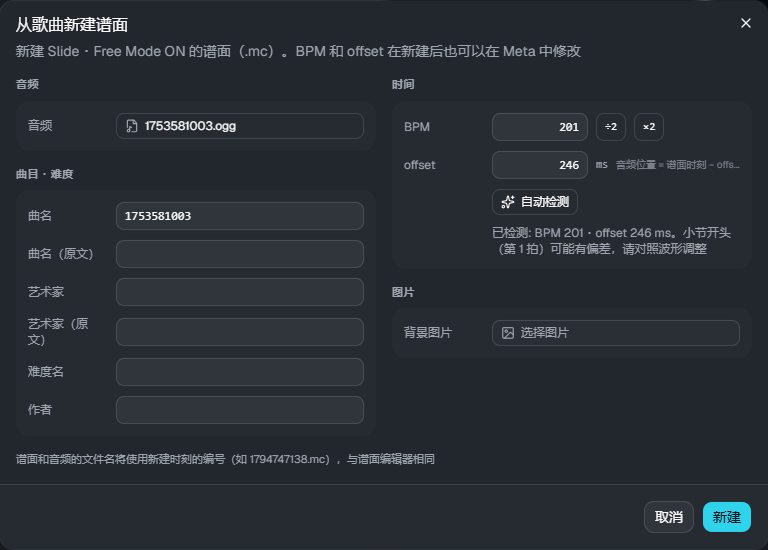
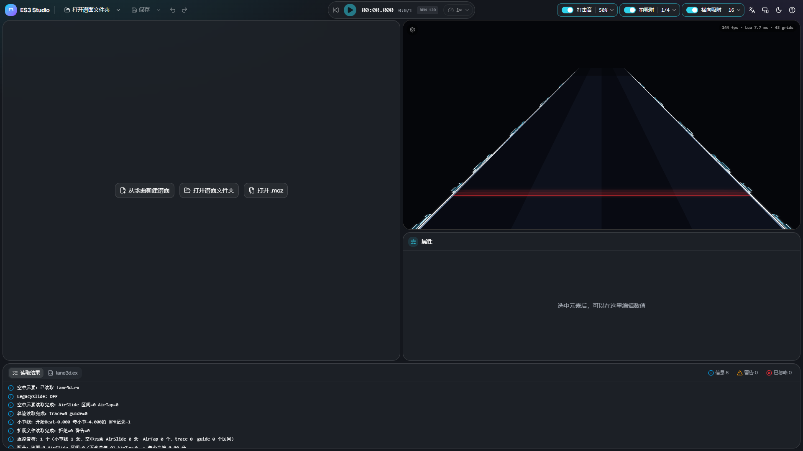
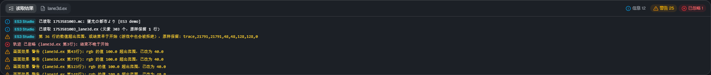
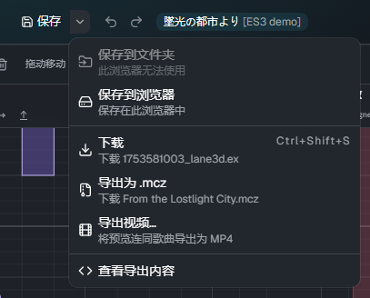
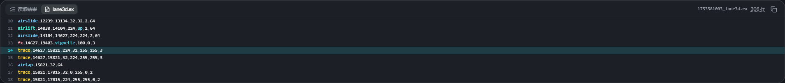
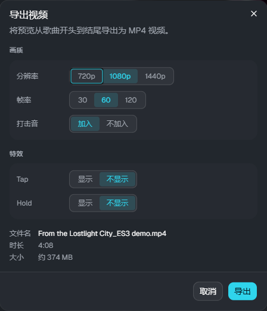

# 打开与保存

[← 返回使用说明首页](index.md)

## 从歌曲新建谱面

可以从还没有谱面的歌曲新建谱面。点击「打开谱面文件夹」旁边的 ▾，或什么都没有打开的画面上的 **「从歌曲新建谱面」**。

1. 点击 **「选择音频」**，选择歌曲文件（`.ogg`・`.mp3`）
2. 会询问「要自动对齐 BPM 和 offset 吗？」。点击 **「检测」** 会从歌曲中找出 BPM 和节拍位置并填入（[时间](meta.md#时间bpmoffset)）。想自己输入时点击「自己输入」
3. 填写曲名・艺术家・难度名・作者。曲名一开始会填入音频的文件名。作者会记住，供下次新建时使用
4. 选择背景图片（可以不选）
5. 点击 **「新建」**，会打开空谱面

- 新建的谱面是 Slide・**Free Mode ON**（ES3 的 3D 轨道需要）
- 谱面和音频的文件名与谱面编辑器相同，使用新建时刻的编号（如 `1794660821.mc`・`1794660821.ogg`）
- 保存（Ctrl+S）会保存到**浏览器中**。在游戏中使用时，请从保存的 ▾ 中选择 **「导出为 .mcz」**，再在游戏中导入
- BPM 和 offset 在新建后也可以在 [Meta](meta.md) 中修改。BPM 中途变化的歌曲，请在谱面编辑器中添加 BPM

## 打开谱面文件夹

点击 **「打开谱面文件夹」**，选择谱面（`.mc`）所在的歌曲文件夹。请选择**文件夹**，而不是文件。

- 文件夹中只有一个谱面时，会直接打开
- 有多个谱面时，会出现选择要编辑的谱面的画面。不是 Slide 的谱面、Free Mode 未开启的谱面、已有扩展文件的谱面会带有标记
- 有尚未保存的修改时，打开前会先确认

在 Chrome・Edge 中，浏览器会询问是否允许网站查看文件。允许后即可打开。

### 读取的文件

从谱面文件夹中读取以下文件。

| 文件                   | 用途                                                                      |
| ---------------------- | ------------------------------------------------------------------------- |
| `<谱面名>.mc`          | 地面音符（编辑后写回）・BPM・谱面的 scroll / jump・音频和背景图片的文件名 |
| `<谱面名>_lane3d.ex`   | 要编辑的扩展文件。没有时会新建                                            |
| `<谱面名>_chart_3d.ex` | 旧名称的扩展文件。仅在没有 `_lane3d.ex` 时读取                            |
| `<谱面名>_lane3d.src`  | 谱面编辑器的 ES3 插件的文件。仅在两种 `.ex` 都没有时读取                  |
| 音频                   | 用于播放。没有时无声播放                                                  |
| 背景图片               | 铺在预览的背景上（会稍微调暗）。没有时不显示背景                          |

## 打开 .mcz・打开浏览器中保存的谱面

从「打开谱面文件夹」旁边的 ▾ 中选择。在什么都没有打开的画面上，按钮并排显示。

- **打开 .mcz**：选择谱面包（`.mcz`）。内容按与谱面文件夹相同的方式读取（内容放在 `0/` 下也能读取）
- **浏览器中保存的谱面**：显示之前通过「保存」保存到浏览器的谱面列表。点击即可接着编辑，点击垃圾桶按钮可删除

## 读取结果

下方面板的 **「读取结果」** 中会显示读取的结果。

- **信息**：读取的文件和元素数量等
- **警告**：可以运行，但最好确认一下
- **已忽略**：游戏中也会被忽略的行。ES3 Studio 也不会把它当作元素，但会**原样保留这一行**并保存

以 `[T3D]` 开头的行是皮肤脚本输出的日志（与游戏中的日志相同。目前是日语）。

## 保存

点击 **「保存」**（Ctrl+S）会保存当前的谱面（`<谱面名>_lane3d.ex`。如果修改了地面音符，还有 `<谱面名>.mc`）。有尚未保存的修改时，按钮上会出现一个点。

- **在 Chrome・Edge 中打开了谱面文件夹时**：直接写入谱面文件夹。第一次保存时，浏览器会请求写入权限
- **其他情况**（从 `.mcz` 打开・其他浏览器）：**保存到浏览器中**，不会下载。在游戏中使用时，请通过下面的「下载」或「导出为 .mcz」导出

保存在浏览器中的谱面，清除浏览器数据后会消失。想保留的谱面请导出。

点击「保存」旁边的 ▾ 可以选择保存方式。

| 菜单                 | 内容                                                                                                                 |
| -------------------- | -------------------------------------------------------------------------------------------------------------------- |
| 保存到文件夹         | 直接写入谱面文件夹（仅限在 Chrome・Edge 中打开文件夹时）                                                             |
| 保存到浏览器         | 保存在此浏览器中。可以从「浏览器中保存的谱面」打开                                                                   |
| 下载（Ctrl+Shift+S） | 下载 `lane3d.ex`（如果修改了谱面，还有 `.mc`）。请放入谱面文件夹（与 `.mc` 同一位置）                                |
| 导出为 .mcz          | 将谱面文件夹的内容（其他难度・音频・背景・封面）和编辑后的 `.mc`・`lane3d.ex` 打包成 `.mcz` 并下载。可以直接导入游戏 |
| 导出视频…            | 将预览连同歌曲导出为 MP4 视频（见下方「导出视频」）                                                                  |
| 查看导出内容         | 打开下方面板的「lane3d.ex」                                                                                          |

第一次覆盖谱面（`.mc`）时，会弹出确认。只会改变修改过的部分（其他部分一个字也不会改）。
但是，写出的 `.mc` 中总会删除 `$ver` 这个标记（谱面编辑器会给 Free Mode 谱面加上它，但有它时旧版 Malody 无法读取谱面）。
如果在 MalodyV 的谱面编辑器中打开着同一谱面，在那边保存时会覆盖 ES3 Studio 中的修改。请先关闭谱面编辑器。

第一次覆盖不是由 ES3 Studio 写出的 `lane3d.ex`（例如手写的文件）时，会弹出确认。
覆盖后，元素会按时间重新排列，注释等非元素行会集中到开头（行的内容会保留）。

### 导出内容

下方面板的 **「lane3d.ex」** 中显示保存后会写入的内容。

- 点击某一行会选中对应的元素（按住 Shift 追加）
- 行号与游戏日志中的「第◯行」一致。游戏中出现警告时，可以在这里找到对应的行
- 点击「复制全部」可以复制到剪贴板

## 导出视频

点击「保存」旁边 ▾ 中的 **「导出视频…」**，可以将预览连同歌曲导出为 MP4 视频。范围为歌曲从头到尾。

- **画质**：可选择分辨率（720p・1080p・1440p）、帧率（30・60・120）以及是否加入打击音
- **特效**：可选择是否显示 Tap / Hold 特效（与预览设置相同）
- 导出所需时间因设备而异。完成前请不要关闭标签页
- 在电脑上的 Chrome・Edge 中可以选择保存位置，其他情况下会直接下载
- 可在最新版的 Chrome・Edge・Firefox・Safari 中使用

## 在游戏中确认

保存后，在游戏中重新打开谱面即可生效。请确认皮肤设为 Extra-Slide v3，并且谱面的 Free Mode 已开启。
