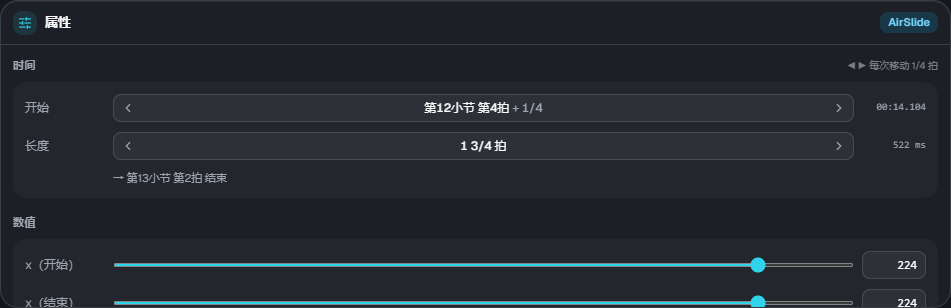
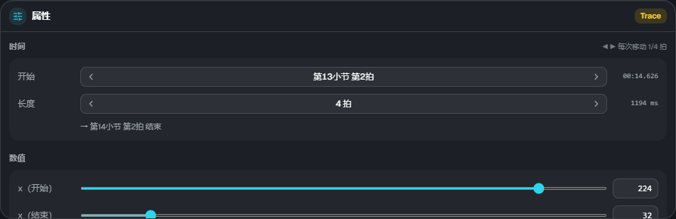

# 属性与元素

[← 返回使用说明首页](index.md)

## 属性

在时间轴上选中一个元素后，可以在右下角的属性中编辑数值。选中多个元素时，会显示选中的数量和操作提示。

### 时间

- **开始**：以「第◯小节 第◯拍＋分数」显示。点击 ◀ ▶ 按拍吸附的步长移动
- **长度**：仅限有区间的元素。点击 ◀ ▶ 伸缩。下方显示结束的位置
- 右端显示游戏中的时间（ms）。`lane3d.ex` 中以这个 ms 写入

### 数值

用滑块或数字框修改。x・宽度・高度为 **0〜255**（与地面音符的坐标相同。64 约等于 1 条轨道）。

- **缓动（ease）**：0 线性 / 1 缓入加速 / 2 快出减速 / 3 两端平缓
- **组**：空中元素和描线可以使用与某个音符组相同的流速（留空则按谱面的 scroll）。→ [流速](flow.md)

颜色（`#rrggbb`）和 wave 的波长目前无法在 ES3 Studio 中修改。`lane3d.ex` 中已写好的内容会原样保留。

## 元素的类型

| 类型            | 轨道 | 内容                                                                                               |
| --------------- | ---- | -------------------------------------------------------------------------------------------------- |
| Tap / Wipe      | 地面 | 地面的单点音符。可在属性中切换 Tap 和 Wipe，并加上滑键的方向（← ↑ →）                              |
| Slide           | 地面 | 沿中继点移动的地面带。在属性的「中继点」中添加点・删除最后一个点                                   |
| AirTap          | 空中 | 空中判定线上的单点音符                                                                             |
| AirLift         | 空中 | 保持 x 不变，在地面 ⇄ 空中判定线之间移动的带（上升 / 下降）。长度为 0 时，会在那一瞬间切换（直角） |
| AirSlide        | 空中 | 在空中判定线上横向移动的带                                                                         |
| Trace           | 描线 | 没有判定的装饰线。可以同时改变 x 和高度，所以也能画斜线                                            |
| Guide           | 描线 | 铺在地面上的半透明带（没有判定）。位置和宽度可以变化                                               |
| 镜头演出（cam） | 镜头 | 倾斜・位置・距离・旋转・缩放等。区间结束后保持结束值（不会自动恢复）                               |
| 画面特效（fx）  | 特效 | 黑场・暗角・噪点・波浪・色差・闪光・震动・故障等                                                   |

元素的详细规则（判定方式・警告的条件等）请参阅[皮肤 Extra-Slide v3 的说明](https://m.mugzone.net/store/skin/detail/7674)。
ES3 Studio 的预览和读取结果中，会显示与游戏相同的警告和忽略信息。
