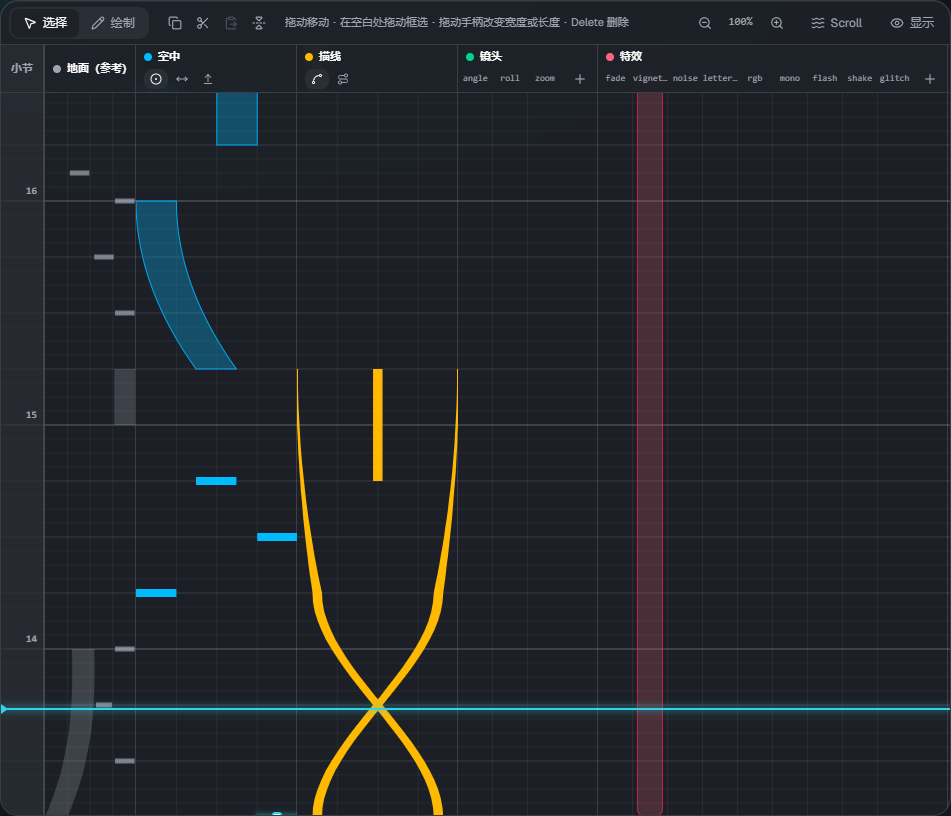
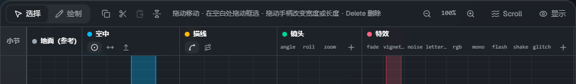
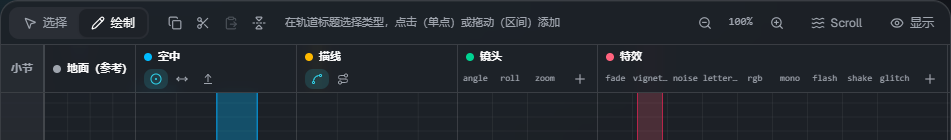
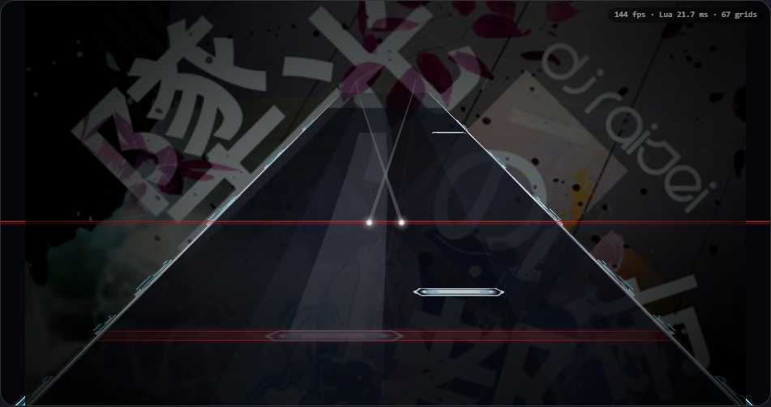

# 时间轴

[← 返回使用说明首页](index.md)

时间**从下往上**流动（与 Malody 编辑器的方向相同）。浅蓝色的横线是当前位置（播放线）。
左端的数字是小节号，小节线按照 `lane3d.ex` 中 `measure` 行的设置绘制。

## 轨道

| 轨道         | 放置的内容                                                          |
| ------------ | ------------------------------------------------------------------- |
| 小节         | 小节刻度。点击或拖动可以把播放线移到该位置                          |
| 地面（参考） | 谱面（`.mc`）中的地面音符。仅供查看，不能编辑。按音符组显示不同颜色 |
| 空中         | AirTap・AirSlide・AirLift                                           |
| 描线         | Trace（线）・Guide（地面上的带）                                    |
| 镜头         | cam。每个项目（angle・roll・zoom 等）一列。点击 ＋ 可以添加列       |
| 特效         | fx。每种类型（fade・flash・glitch 等）一列。点击 ＋ 可以添加列      |

点击右上角的 **「显示」** 可以隐藏或显示轨道。

## 工具栏

从左到右依次是：**选择 / 绘制**切换，复制・剪切・粘贴・左右翻转，操作提示，缩放，**Scroll**（[流速](flow.md)），显示的轨道。

## 选择与移动（选择模式）

**选择**（V）模式下的操作：

- 点击元素选中，拖动可以移动
- 拖动选中元素上出现的**手柄**，可以改变宽度・长度・结束位置・描线的高度
- 在空白处拖动可以框选。**Shift+点击** 添加 / 移除选择
- **Delete**（或 Backspace）删除，**Esc** 取消选择
- 选中多个元素时可以一起移动

## 添加（绘制模式）

切换到 **绘制**（B），在轨道上点击或拖动即可添加元素。

- 空中・描线轨道用标题中的小按钮选择**类型**（点击后会切换到绘制模式）
- **点击**添加单点（AirTap），**拖动**添加区间（AirSlide・Trace 等）。向上拖动到的位置就是结束位置
- 镜头・特效：在想要的项目列上点击或拖动
- 新添加音符的宽度使用最后一次修改的宽度

已选中元素时点击轨道，会先取消选择（再点击一次即可添加）。

## 吸附

用工具栏的 **拍吸附** 和 **横向吸附** 设置放置和移动时的步长。

- **拍吸附**：每拍的细分（1/1〜1/16）
- **横向吸附**：横向位置的步长（8・16・32・64。64 约等于 1 条轨道）
- 用左边的开关切换开 / 关。按住 **Alt** 时两者都会暂时关闭

## 缩放

用 **Ctrl+滚轮** 或工具栏的 − / ＋，可以把每拍的高度调整为 25〜400%。点击倍率可以恢复到 100%。

## 复制・粘贴・左右翻转

| 操作                   | 按键            |
| ---------------------- | --------------- |
| 全选                   | Ctrl+A          |
| 复制 / 剪切            | Ctrl+C / Ctrl+X |
| 粘贴（到播放线的位置） | Ctrl+V          |
| 左右翻转               | H               |

## 播放与预览

- **Space** 播放 / 暂停，**Home** 回到开头。工具栏上显示时间・小节:拍・BPM
- 预览直接运行皮肤的脚本，所以和游戏中的效果相同。修改元素后稍等片刻就会反映
- **打击音**：播放时在地面与空中音符的头部发出声音（描线不发声）。点击 ▾ 可以调整音量

## 快捷键

| 按键                  | 内容                      |
| --------------------- | ------------------------- |
| Space                 | 播放 / 暂停               |
| Home                  | 回到开头                  |
| V / B                 | 选择模式 / 绘制模式       |
| Delete・Backspace     | 删除选中的元素            |
| Esc                   | 取消选择                  |
| Ctrl+A / C / X / V    | 全选 / 复制 / 剪切 / 粘贴 |
| H                     | 左右翻转                  |
| Alt（按住时）         | 暂时关闭吸附              |
| Ctrl+滚轮             | 缩放                      |
| Ctrl+S / Ctrl+Shift+S | 保存 / 下载保存           |

在输入框中输入文字时，除保存以外的快捷键都不会生效。
